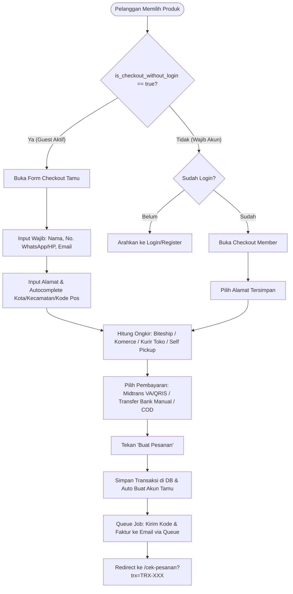
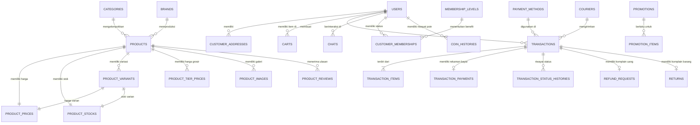
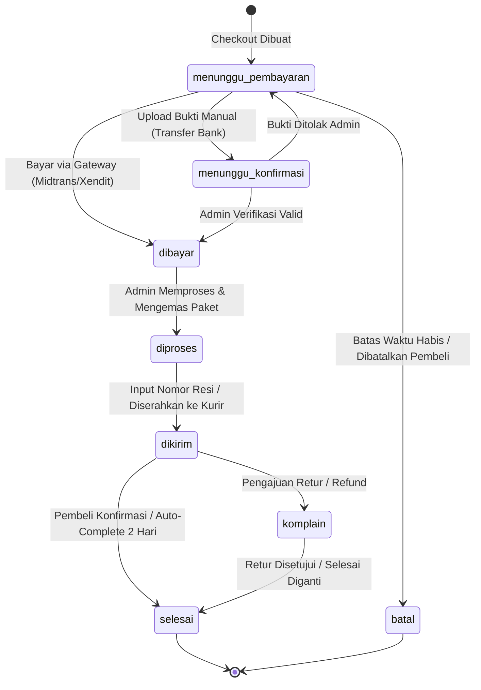

# 📘 Dokumentasi Lengkap Sistem, Fitur, Database, dan Setup E-Commerce Bizmate

Dokumentasi ini menyajikan analisis mendalam mengenai seluruh arsitektur sistem, skema database, modul fitur (Storefront, Admin, Kurir, Seller), integrasi third-party, serta panduan setup lengkap aplikasi e-commerce **Bizmate**.

---

## 📑 Daftar Isi
1. [Ringkasan Arsitektur & Tech Stack](#1-ringkasan-arsitektur--tech-stack)
2. [Peta Fitur & Modul Aplikasi](#2-peta-fitur--modul-aplikasi)
   - [A. Storefront & Customer Experience](#a-storefront--customer-experience)
   - [B. Alur Checkout & Guest Checkout Tanpa Login](#b-alur-checkout--guest-checkout-tanpa-login)
   - [C. Pelacakan Pesanan (Cek Pesanan) & Notifikasi Email Queue](#c-pelacakan-pesanan-cek-pesanan--notifikasi-email-queue)
   - [D. Portal Kurir Internal (Kurir Toko)](#d-portal-kurir-internal-kurir-toko)
   - [E. Admin Backoffice & Master Data](#e-admin-backoffice--master-data)
   - [F. Sistem Multi-Vendor & Iklan Produk (Seller Ads & Listing)](#f-sistem-multi-vendor--iklan-produk-seller-ads--listing)
   - [G. Integrasi AI (Deskripsi & Gambar)](#g-integrasi-ai-deskripsi--gambar)
3. [Arsitektur Database & Entity Relationship](#3-arsitektur-database--entity-relationship)
   - [Diagram Relasi Inti (ERD)](#diagram-relasi-inti-erd)
   - [Kamus Data Tabel Utama](#kamus-data-tabel-utama)
4. [Alur Kerja Transaksi & Status Lifecycle](#4-alur-kerja-transaksi--status-lifecycle)
5. [Integrasi Eksternal & Webhook API](#5-integrasi-eksternal--webhook-api)
6. [Panduan Instalasi & Setup Lengkap (Local & Production)](#6-panduan-instalasi--setup-lengkap-local--production)
7. [Variabel Lingkungan (.env Reference)](#7-variabel-lingkungan-env-reference)

---

## 1. Ringkasan Arsitektur & Tech Stack

Aplikasi ini dibangun menggunakan arsitektur **Modern Monolith SPA** yang menggabungkan keandalan backend Laravel dengan kecepatan reaktif frontend Svelte 5 via Inertia.js v3 tanpa latensi REST/GraphQL boilerplate tradisional.

```
┌────────────────────────────────────────────────────────┐
│                   CLIENT (SPA)                         │
│  Svelte 5 (Runes) + Tailwind CSS v4 + Wayfinder Typed  │
└──────────────────────────┬─────────────────────────────┘
                           │ Inertia.js v3 Protocol
┌──────────────────────────▼─────────────────────────────┐
│                 BACKEND (LARAVEL 13)                   │
│   PHP 8.3 | Routing | Form Requests | Actions | Queues │
└──────┬───────────────┬───────────────┬───────────────┬─┘
       │               │               │               │
┌──────▼──────┐ ┌──────▼──────┐ ┌──────▼──────┐ ┌──────▼──────┐
│  DATABASE   │ │ LOGISTIK    │ │ PAYMENT GW  │ │ REALTIME    │
│ MySQL/SQLite│ │ Biteship    │ │ Midtrans    │ │ Reverb      │
│ 40+ Tables  │ │ Komerce     │ │ Xendit/Flip │ │ WebSockets  │
└─────────────┘ └─────────────┘ └─────────────┘ └─────────────┘
```

- **Backend Framework**: Laravel 13 running on PHP 8.3
- **Frontend Framework**: Svelte 5 (menggunakan *Runes*: `$state`, `$derived`, `$props`, `$effect`)
- **SPA Bridge**: Inertia.js v3 (HTTP standalone, partial reloads, layout props, flash updates)
- **CSS Engine**: Tailwind CSS v4 dengan sistem palet dinamis berbasis *theme settings*
- **Route Typing**: `@laravel/vite-plugin-wayfinder` (auto-generated TypeScript routes & controller actions)
- **Database Engine**: MySQL / PostgreSQL / SQLite dengan 40+ tabel terindeks optimal
- **Background Processing**: Laravel Database/Redis Queue (Email pengiriman faktur, webhook processing, notifikasi)
- **Broadcasting & Real-time**: Laravel Reverb WebSockets untuk live chat dan update status pesanan
- **Testing Suite**: Pest PHP 4 (412+ automated tests covering features, RBAC, checkout, and pricing logic)
- **Code Standards**: Laravel Pint (PSR-12 compliant)

---

## 2. Peta Fitur & Modul Aplikasi

### A. Storefront & Customer Experience

| Fitur | Rute / Komponen | Keterangan |
|---|---|---|
| **Beranda Interaktif** | `/` (`Home.svelte`) | Hero carousel banner CMS, flash sale running timer, rekomendasi produk personal, kategori pilihan, brand slider, PWA install prompt. |
| **Katalog & Pencarian Cepat** | `/search`, `/c/{slug}`, `/brands` | Filter harga, kategori, brand, urutan (terlaris, termurah, termahal, terbaru), live suggestion. |
| **Halaman Produk Kaya Fitur** | `/products/{product}` (`Product.svelte`) | Galeri foto thumbnail, video player (Plyr.js), 3D Model AR viewer (`.glb` / `.usdz`), size chart modal, rating ulasan dengan filter foto. |
| **Variasi & Multi-Tier Pricing** | `VariantSelectorModal.svelte` | Kombinasi multi-varian (Warna x Ukuran) dengan harga bertingkat (*wholesale/tier pricing*) otomatis sesuai kuantiti. |
| **Flash Sale & Promo Khusus** | `/flash-sale`, `/produk-terlaris` | Countdown timer otomatis, progress bar sisa kuota flash sale, diskon toko, dan promo bundling (*Buy X Get Y Free*). |
| **Keranjang Belanja Pintar** | `/cart` (`Cart.svelte`) | Seleksi checklist per-item (`is_checked`), update kuantiti instan, pemilihan voucher diskon belanja & gratis ongkir, serta dukungan keranjang tamu (*Guest Cart*). |
| **Live Chat CS Toko** | `/chats` (`Chat.svelte`) | Komunikasi real-time pembeli & admin toko, upload foto lampiran, stiker chat kustom. |
| **Ulasan & Rating** | `POST /transactions/{trx}/review` | Ulasan berbintang 1-5, deskripsi pengalaman, upload foto produk asli, opsi ulasan anonim (*sembunyikan nama*). |
| **Retur & Refund Barang** | `/returns`, `/refunds` | Pengajuan komplain barang cacat/salah, upload foto/video bukti, pemilihan alasan, nomor resi pengembalian, proses penggantian barang atau uang kembali. |

---

### B. Alur Checkout & Guest Checkout Tanpa Login

Sistem mendukung 2 mode pembelian: **Checkout Pelanggan Terdaftar** dan **Checkout Tamu (Guest Checkout)** yang dikontrol via environment variable `is_checkout_without_login`:



1. **Aturan Validasi Tamu**:
   - `customer_name`: Wajib diisi.
   - `customer_phone`: Wajib diisi, format nomor seluler minimal 8 digit (untuk konfirmasi kurir/WhatsApp).
   - `customer_email`: Wajib diisi, format email valid (untuk pengiriman bukti pesanan & link pelacakan).
   - Alamat pengiriman lengkap + kode pos.
2. **Opsi Pengiriman Komprehensif**:
   - **Kurir Ekspedisi (Biteship & Komerce)**: JNE, J&T, SiCepat, Anteraja, GoSend, GrabExpress, IDExpress, Lion Parcel, SAP, Ninja Express.
   - **Kurir Toko (Internal)**: Penghitungan otomatis jarak radius (*Haversine formula*) dari titik GPS koordinat toko ke koordinat alamat pemesan (Tarif Flat, Tarif per-Km, atau Tarif Tiered bertingkat).
   - **Ambil di Toko (*Self Pickup*)**: Bebas ongkir, pemesan memilih tanggal dan slot waktu pengambilan (per 30 menit) sesuai jam operasional toko.
   - **Produk Digital**: Tanpa ongkir, pengiriman lisensi/file via email dan halaman detail transaksi.
3. **Metode Pembayaran Lengkap**:
   - **Payment Gateway (Midtrans Core API)**: BCA VA, Mandiri Bill, BNI VA, BRI VA, Permata VA, CIMB VA, QRIS (Gopay/ShopeePay/Semua E-Wallet).
   - **Transfer Bank Manual**: Verifikasi admin dengan upload bukti transfer (*payment proof*).
   - **Cash on Delivery (COD)**: Pembayaran tunai saat barang diterima kurir dengan batasan kurir tertentu.

---

### C. Pelacakan Pesanan (Cek Pesanan) & Notifikasi Email Queue

- **Halaman Khusus**: `/cek-pesanan` ([TrackOrder.svelte](file:///Users/macbookair/Documents/website/ecommerce/ecommerce-bizmate/resources/js/pages/Storefront/TrackOrder.svelte))
- **Aksesibilitas**: Tersedia tombol "Cek Pesanan" pada Topbar Desktop, Dropdown Profil, dan Mobile Sidebar Drawer.
- **Mekanisme Keamanan**:
  - Pelanggan memasukkan **Nomor Pesanan** (contoh: `TRX-20261102-XXXX`) dan **Email atau Nomor HP**.
  - Sistem memverifikasi kecocokan kontak sebelum menampilkan data sensitif (alamat pengiriman, status pembayaran, item belanja).
- **Fitur di Halaman Pelacakan**:
  - Badge status pesanan real-time (*Menunggu Pembayaran, Dibayar, Diproses, Dikirim, Selesai, Dibatalkan*).
  - Countdown timer sisa batas waktu pembayaran (auto-cancel jika melewati batas kedaluwarsa).
  - Panduan rekening transfer dan modal unggah bukti pembayaran langsung di halaman pelacakan.
  - Tracking status pengiriman live (ekspedisi & nomor resi pengiriman).
  - Tombol WhatsApp CS toko langsung membawa konteks nomor transaksi yang sedang dilacak.
- **Asynchronous Email Queue**:
  - Email konfirmasi order menggunakan Mailable [OrderConfirmation.php](file:///Users/macbookair/Documents/website/ecommerce/ecommerce-bizmate/app/Mail/OrderConfirmation.php) yang mengimplementasikan `ShouldQueue`.
  - Pekerjaan email dikirimkan ke worker antrean (`php artisan queue:work`), menjaga respon request checkout tetap di bawah 200ms tanpa terhambat latency koneksi SMTP.

---

### D. Portal Kurir Internal (Kurir Toko)

Portal khusus untuk armada pengiriman internal toko dengan URL `/kurir`:
- **Login Khusus Kurir**: `/kurir/login` tervalidasi guard Spatie role `Kurir`.
- **Dashboard Tugas Pengiriman**: Daftar paket yang ditugaskan (*assigned*), rute tujuan, nomor telepon pemesan (dengan tombol WhatsApp direct call), dan alamat di peta.
- **Barcode & QR Scanner**: Memindai label resi cetak untuk langsung membuka rincian pesanan.
- **Penyelesaian Pengiriman Anti-Fraud**:
  - Pengambilan foto bukti serah terima paket (*Proof of Delivery photos*).
  - Input nama penerima (misal: "Ybs", "Keluarga serumah", "Satpam").
  - Catatan pengiriman dan cap waktu kedatangan (*timestamp arrived*).

---

### E. Admin Backoffice & Master Data

Modul admin dapat diakses di `/admin` dengan proteksi middleware otorisasi:

1. **Dashboard Eksekutif**:
   - Total Pendapatan (GMV), Total Pesanan Sukses, Nilai Transaksi Rata-Rata (AOV), Jumlah Pengguna Aktif.
   - Grafik Penjualan Harian/Bulanan berbasis Chart.js.
   - Analisis Pareto 80/20 (identifikasi 20% produk yang menyumbang 80% omset).
   - Widget Peringatan Stok Menipis (*Low Stock Alert*).
2. **Manajemen Produk & Varian**:
   - Multi-image upload, crop editor, reordering gambar.
   - Multi-opsi varian (SKU otomatis, barcode, stok per varian, harga modal, harga promo).
   - Harga Grosir/Tier Pricing berdasarkan minimal pembelian.
   - Media 3D AR Viewer (`.glb` / `.usdz`) dan link video interaktif.
   - Generator deskripsi AI & Image AI terintegrasi.
3. **Manajemen Transaksi & Logistik**:
   - Filter status komprehensif, pencarian nomor resi/nama pembeli.
   - Verifikasi & persetujuan pembayaran bukti transfer manual (*Approve / Reject dengan alasan*).
   - Cetak Faktur/Invoice PDF, Cetak Label Pengiriman / Packing Slip dengan Barcode.
   - Sinkronisasi pelacakan resi otomatis via Webhook Biteship & Komerce.
   - Pembaruan status massal (*Bulk update status* & *Bulk input resi*).
4. **Program Promosi & Loyalty**:
   - **Flash Sale**: Pengaturan jadwal mulai/selesai, kuota terbatas, banner promo.
   - **Diskon Produk**: Potongan harga flat atau persentase per kategori/produk.
   - **Voucher Toko**: Voucher Belanja dan Voucher Bebas Ongkir (kode voucher, kuota klaim, minimal belanja, maks diskon).
   - **Bundling Gift**: Promosi beli produk X gratis produk Y.
   - **Koin Loyalty (Points)**: Rasio perolehan koin dari transaksi belanja, rasio konversi saat checkout, dan tingkat perolehan koin bertingkat.
5. **Sistem Keanggotaan VIP (Membership)**:
   - Level keanggotaan (Classic, Bronze, Silver, Gold, Platinum).
   - Pengaturan syarat akumulasi transaksi / poin belanja.
   - Keuntungan eksklusif: diskon otomatis saat checkout, bonus cashback poin, early access promo sebelum rilis umum.
6. **Laporan & Analitik Bisnis**:
   - Laporan Penjualan (Harian, Mingguan, Bulanan, Rentang Kustom).
   - Laporan Laba Rugi (HPP / Biaya Modal vs Omset Penjualan Bersih).
   - Laporan Stok & Valuasi Aset Inventaris.
   - Laporan Keranjang Terbengkalai (*Abandoned Carts*).
   - Laporan Efektivitas Kurir & Biaya Ekspedisi.
   - Laporan Ulasan & Sentimen Kepuasan Pelanggan.

---

### F. Sistem Multi-Vendor & Iklan Produk (Seller Ads & Listing)

Konfigurasi opsional ketika platform bertindak sebagai marketplace (`IS_SELLER=true`):
- **Registrasi Penjual (*Become Seller*)**: Toko terverifikasi, halaman etalase toko `/toko/{slug}`.
- **Biaya Listing Produk (*Product Listing Payment*)**: Kebijakan bayar per posting produk dengan durasi masa aktif iklan (30, 60, 90 hari) terintegrasi payment gateway.
- **Seller Ads (Promote Produk)**:
  - Dompet Saldo Iklan Penjual (*Seller Ad Wallet* & Top-up saldo).
  - Model lelang CPC (*Cost Per Click*) atau CPM (*Cost Per Mille/1000 Views*).
  - Penempatan iklan (Halaman Utama, Hasil Pencarian Teratas, Produk Serupa).
  - Badge "Sponsored / Teriklan" pada kartu produk.

---

### G. Integrasi AI (Deskripsi & Gambar)

- **AI Product Description Generator**: Menghasilkan deskripsi penjualan persuasif, bullet point spesifikasi, dan tag SEO menggunakan OpenAgentic / Gemini API berdasarkan nama produk dan kategori.
- **AI Product Image Generator**: Pembuatan variasi foto latar belakang studio produk secara otomatis.
- **Google Reverse Image Search**: Pencarian referensi foto produk dan spesifikasi dari web via Google Custom Search API.

---

## 3. Arsitektur Database & Entity Relationship

Database dirancang dengan normalisasi tingkat tinggi (3NF) serta penambahan indeks komposit pada kolom-kolom kritis (`created_at`, `status`, `user_id`, `product_id`) untuk menjamin performa kueri transaksi skala besar.

### Diagram Relasi Inti (ERD)



---

### Kamus Data Tabel Utama

#### 1. Tabel `users`
Menyimpan kredensial autentikasi pengguna, profil, saldo koin, dan asosiasi peran Spatie (Admin, Customer, Kurir, Seller).
- `id` (UUID / BigInt, PK)
- `name` (VARCHAR): Nama lengkap pengguna.
- `email` (VARCHAR, Unique): Alamat surel.
- `phone_number` (VARCHAR): Nomor WhatsApp aktif.
- `password` (VARCHAR): Hash Bcrypt kata sandi.
- `coins_balance` (INT): Saldo koin loyalty saat ini (default: 0).
- `email_verified_at` (TIMESTAMP, Nullable): Waktu verifikasi surel.
- `is_active` (BOOLEAN): Status keaktifan akun.
- `is_seller` (BOOLEAN): Penanda apakah user terdaftar sebagai penjual.

#### 2. Tabel `products`
Katalog induk seluruh produk fisik dan digital.
- `id` (UUID / BigInt, PK)
- `category_id` (FK -> categories.id): Kategori produk.
- `brand_id` (FK -> brands.id, Nullable): Merek produk.
- `name` (VARCHAR): Nama produk.
- `slug` (VARCHAR): URL ramah SEO.
- `sku` (VARCHAR, Unique): Kode unik stok unit.
- `description` (TEXT): Deskripsi lengkap produk (HTML Rich Text).
- `summary` (VARCHAR): Ringkasan singkat produk.
- `is_digital` (BOOLEAN): Penanda produk fisik (butuh ongkir) atau digital (tanpa ongkir).
- `is_promo` (BOOLEAN): Status apakah sedang dalam promo diskon.
- `promo_price` (DECIMAL): Harga promo aktif.
- `weight_grams` (INT): Berat produk dalam gram untuk kalkulasi ongkos kirim.
- `has_variants` (BOOLEAN): Apakah produk memiliki kombinasi varian.
- `condition` (ENUM: `new`, `used`): Kondisi barang baru atau bekas.

#### 3. Tabel `product_variants` & `product_prices` & `product_stocks`
Arsitektur terpisah untuk variasi produk dan inventaris:
- `product_variants`: Kombinasi atribut (`name`, `sku`, `weight_grams`).
- `product_prices`: Menyimpan `price` (harga jual normal) dan `cost` (harga modal / HPP untuk kalkulasi laba rugi).
- `product_stocks`: Menyimpan `stock` saat ini dan boolean `is_unlimited`.

#### 4. Tabel `transactions`
Jantung operasional transaksi e-commerce.
- `id` (UUID / BigInt, PK)
- `transaction_number` (VARCHAR, Unique): Kode transaksi publik (contoh: `TRX-20261102-0001`).
- `user_id` (FK -> users.id): ID pembeli (termasuk user yang digenerate otomatis pada guest checkout).
- `customer_name`, `customer_email`, `customer_phone` (VARCHAR): Snapshot kontak pemesan.
- `customer_address_id` (FK -> customer_addresses.id, Nullable): Alamat pengiriman yang dipilih.
- `payment_method_id` (FK -> payment_methods.id): Metode pembayaran yang dipilih.
- `subtotal` (DECIMAL): Total harga produk sebelum diskon.
- `shipping_fee` (DECIMAL): Biaya pengiriman barang.
- `application_fee` (DECIMAL): Biaya layanan aplikasi.
- `additional_costs` (JSON): Rincian biaya tambahan (misal: Asuransi, Packing Kayu).
- `discount_amount` (DECIMAL): Total potongan harga (voucher toko + voucher ongkir + diskon membership).
- `coins_redeemed` (INT): Jumlah koin loyalty yang digunakan sebagai potongan bayar.
- `grand_total` (DECIMAL): Nominal akhir yang wajib dibayar.
- `status` (VARCHAR): `menunggu_pembayaran`, `dibayar`, `diproses`, `dikirim`, `selesai`, `batal`.
- `payment_status` (VARCHAR): `belum_dibayar`, `menunggu_konfirmasi`, `lunas`, `kedaluwarsa`, `gagal`.
- `shipping_courier` (VARCHAR): Kode kurir (`jne`, `jnt`, `sicepat`, `store_courier`, `self_pickup`, `digital`).
- `shipping_service` (VARCHAR): Layanan kurir (`REG`, `YES`, `Instant`, `Self Pickup`).
- `tracking_number` (VARCHAR, Nullable): Nomor resi pengiriman ekspedisi.
- `courier_user_id` (FK -> users.id, Nullable): ID kurir toko internal yang ditugaskan.
- `pickup_at` (TIMESTAMP, Nullable): Waktu jadwal pengambilan untuk metode Self Pickup.
- `delivery_photos` (JSON, Nullable): Foto bukti penerimaan paket oleh kurir.

#### 5. Tabel `transaction_items`
Snapshot produk yang dibeli saat transaksi terjadi:
- `id` (PK)
- `transaction_id` (FK -> transactions.id)
- `product_id` (FK -> products.id)
- `product_variant_id` (FK -> product_variants.id, Nullable)
- `quantity` (INT): Jumlah yang dibeli.
- `price` (DECIMAL): Harga per unit saat checkout.
- `cost_price` (DECIMAL): HPP modal saat checkout untuk audit laba rugi.
- `subtotal` (DECIMAL): `quantity * price`.
- `notes` (VARCHAR, Nullable): Catatan khusus item (misal: "Ukuran XL, warna Navy").

#### 6. Tabel `customer_addresses`
Buku alamat pembeli yang mendukung penentuan ongkir otomatis.
- `user_id` (FK -> users.id)
- `receiver_name` & `phone_number` (VARCHAR)
- `full_address` (TEXT): Alamat jalan, nomor rumah, RT/RW, patokan.
- `province_name`, `regency_name`, `district_name`, `village_name`, `postal_code` (VARCHAR)
- `latitude` & `longitude` (DECIMAL): Titik koordinat GPS peta untuk Kurir Toko.
- `biteship_area_id` (VARCHAR, Nullable): ID area terstandarisasi Biteship API.
- `is_primary` (BOOLEAN): Status alamat utama.

#### 7. Tabel `promotions` & `promotion_items`
- Menangani tipe promo: `flash_sale`, `diskon_produk`, `voucher_belanja`, `voucher_gratis_ongkir`, `bundling_gift`.
- Menyimpan batas waktu `start_time` & `end_time`, kuota `usage_limit`, minimal belanja `min_purchase`, dan nilai potongan `discount_value`.

#### 8. Tabel `membership_levels` & `customer_memberships`
- Level loyalitas pembeli: nama level, syarat akumulasi transaksi, persentase diskon checkout otomatis, rasio cashback koin belanja, dan voucher klaim bulanan.

---

## 4. Alur Kerja Transaksi & Status Lifecycle



### Mutasi Stok Otomatis (*Stock Movements*)
Setiap perubahan stok tercatat pada tabel `stock_movements`:
1. **Pengurangan Stok**: Begitu transaksi berstatus `dibayar` atau saat checkout dibuat.
2. **Pengembalian Stok (*Restock*)**: Jika pesanan dibatalkan (`batal`), kuota stok dikembalikan seketika.
3. **Audit Admin**: Catatan mutasi mencatat `reference_type`, `quantity`, `current_stock`, dan `user_id` eksekutor.

---

## 5. Integrasi Eksternal & Webhook API

Aplikasi dilengkapi *Webhook Handler* yang terproteksi signature HMAC untuk memproses konfirmasi pihak ketiga secara aman:

| Layanan | Endpoint Webhook | Fungsi |
|---|---|---|
| **Midtrans Snap / Core** | `POST /api/webhooks/midtrans` | Menangkap notifikasi pembayaran VA, QRIS, GoPay, dan kartu kredit. Mengubah status transaksi menjadi `dibayar` otomatis. |
| **Biteship Logistic** | `POST /api/webhooks/biteship` | Menerima pembaruan resi pelacakan kurir (Pick up, In transit, Delivered) dan memperbarui tracking history. |
| **Komerce Ekspedisi** | `POST /api/webhooks/komerce` | Sinkronisasi status pengiriman ekspedisi kurir lokal Komerce. |
| **Flip & Xendit** | `POST /api/webhooks/flip`, `/xendit` | Integrasi pembayaran tagihan listing produk seller dan pencairan dana refund. |
| **Google OAuth** | `GET /auth/google/callback` | Social Login Google satu klik untuk customer. |
| **PadelGigs SSO** | `GET /auth/padelgigs/callback` | Single Sign-On komunitas olahraga PadelGigs. |

---

## 6. Panduan Instalasi & Setup Lengkap (Local & Production)

### Prasyarat Server / Komputer
- **PHP**: Versi `>= 8.3` dengan ekstensi: `pdo`, `mbstring`, `openssl`, `curl`, `gd`, `zip`, `bcmath`.
- **Database**: MySQL 8.0+, MariaDB 10.5+, atau PostgreSQL 14+ (SQLite didukung untuk testing).
- **Node.js**: Versi `>= 20.x` & Paket Manager `bun` atau `npm`.
- **Composer**: Versi `>= 2.7.x`.

---

### Langkah Instalasi Bertahap

#### 1. Clone Repositori & Masuk Direktori
```bash
git clone <repository_url> ecommerce-bizmate
cd ecommerce-bizmate
```

#### 2. Pasang Dependensi Backend & Frontend
```bash
# Pasang dependensi PHP
composer install --no-interaction --prefer-dist --optimize-autoloader

# Pasang dependensi Node.js (direkomendasikan bun)
bun install
# atau menggunakan npm:
# npm install
```

#### 3. Konfigurasi Environment File
Salin file template konfigurasi dan generate encryption key:
```bash
cp .env.example .env
php artisan key:generate
```

#### 4. Konfigurasi Database di `.env`
Buka file `.env` dan sesuaikan koneksi database Anda:
```dotenv
DB_CONNECTION=mysql
DB_HOST=127.0.0.1
DB_PORT=3306
DB_DATABASE=bizmate_ecommerce
DB_USERNAME=root
DB_PASSWORD=rahasia
```

#### 5. Jalankan Migrasi & Seeder Database
Inisialisasi tabel, peran Spatie, dan data master bawaan:
```bash
php artisan migrate --seed
```

> [!TIP]
> Jika ingin mengisi toko dengan contoh produk, varian, kategori, promo, dan data dummy lengkap untuk uji coba, jalankan:
> ```bash
> php artisan db:seed --class=DummyTransactionSeeder
> ```

#### 6. Hubungkan Simbolik Storage
Agar foto produk, banner CMS, dan bukti pembayaran dapat diakses publik:
```bash
php artisan storage:link
```

#### 7. Generate Typed Routes Wayfinder
Jalankan sinkronisasi fungsi rute TypeScript untuk frontend:
```bash
php artisan wayfinder:generate
```

#### 8. Menjalankan Server di Lingkungan Pengembangan (Development)
Jalankan server aplikasi secara simultan:
```bash
# Menjalankan server lokal PHP, Vite HMR, Queue Worker, dan Reverb WebSockets
composer run dev
```
Atau secara terpisah pada terminal berbeda:
```bash
# Terminal 1: Laravel Backend
php artisan serve

# Terminal 2: Vite Dev Server (Frontend Hot Reload)
bun run dev

# Terminal 3: Queue Worker (Email & Background Jobs)
php artisan queue:work --tries=3

# Terminal 4: Reverb WebSocket Server (Live Chat & Realtime Broadcast)
php artisan reverb:start
```

Buka browser pada alamat: `http://localhost:8000`.

---

### Setup untuk Lingkungan Produksi (Deployment)

1. **Optimasi Asset Frontend**:
   ```bash
   bun run build
   ```
2. **Optimasi Cache Laravel**:
   ```bash
   php artisan config:cache
   php artisan route:cache
   php artisan view:cache
   php artisan event:cache
   ```
3. **Supervisor Process Runner (Wajib untuk Queue & Reverb)**:
   Buat konfigurasi supervisor di `/etc/supervisor/conf.d/bizmate-worker.conf`:
   ```ini
   [program:bizmate-queue]
   process_name=%(program_name)s_%(process_num)02d
   command=php /path/to/ecommerce-bizmate/artisan queue:work --sleep=3 --tries=3 --max-time=3600
   autostart=true
   autorestart=true
   user=www-data
   numprocs=2
   redirect_stderr=true
   stdout_logfile=/path/to/ecommerce-bizmate/storage/logs/queue.log
   ```

---

## 7. Variabel Lingkungan (.env Reference)

Tabel berikut merangkum konfigurasi utama yang ada pada `.env`:

| Kunci Konfigurasi | Nilai Default | Penjelasan |
|---|---|---|
| `is_checkout_without_login` | `false` | Jika `true`, pelanggan dapat melakukan pembelian langsung tanpa mendaftar akun. |
| `CHECKOUT_LOCKED` | `false` | Mode darurat: Jika `true`, tombol checkout terkunci dengan pesan kustom `CHECKOUT_LOCKED_MESSAGE`. |
| `MEMBERSHIP_ENABLED` | `true` | Mengaktifkan/menonaktifkan seluruh fitur loyalty poin dan tingkatan member VIP. |
| `MIDTRANS_ENABLED` | `true` | Mengaktifkan pembayaran otomatis via Midtrans Snap / Core API. |
| `LOGISTIC_ENABLED` | `true` | Mengaktifkan kalkulasi tarif otomatis kurir ekspedisi. |
| `ENABLE_3D_MODELS` | `true` | Menampilkan viewer model 3D interaktif pada detail produk. |
| `ENABLE_PRODUCT_VARIANTS`| `true` | Mengaktifkan dukungan produk multi-varian. |
| `AI_ENABLED` | `true` | Menampilkan generator AI deskripsi produk dan generator gambar. |
| `OPENAGENTIC_API_KEY` | `""` | Kunci API untuk asisten generator deskripsi AI produk. |
| `IS_SELLER` | `false` | Mengaktifkan fitur multi-penjual, biaya listing toko, dan iklan produk bersponsor. |
| `QUEUE_CONNECTION` | `database` | Driver pemrosesan antrean asinkron (email order konfirmasi, resi). |
| `BROADCAST_CONNECTION` | `reverb` | Driver real-time WebSocket untuk chat dan update pesanan langsung. |
| `GOOGLE_CLIENT_ID` | `""` | Kredensial Google OAuth untuk login sosial akun pembeli. |

---

### Kredensial Default Setelah Seeder
- **Admin Portal** (`/admin/dashboard`):
  - Email: `admin@bizmate.id`
  - Password: `password` (Role: `Administrator`)
- **Kurir Toko** (`/kurir/login`):
  - Email: `kurir@bizmate.id`
  - Password: `password` (Role: `Kurir`)
- **Customer Demo**:
  - Email: `customer@bizmate.id`
  - Password: `password` (Role: `Customer`)

---
*Dokumentasi ini disusun secara komprehensif untuk memudahkan pemeliharaan, pengembangan fitur lanjutan, onboarding developer baru, dan proses audit sistem e-commerce Bizmate.*

