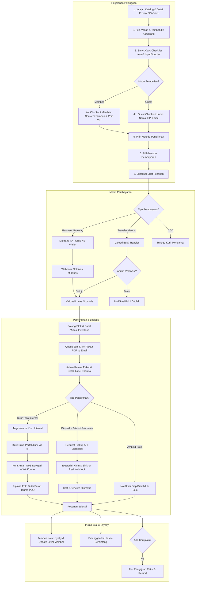
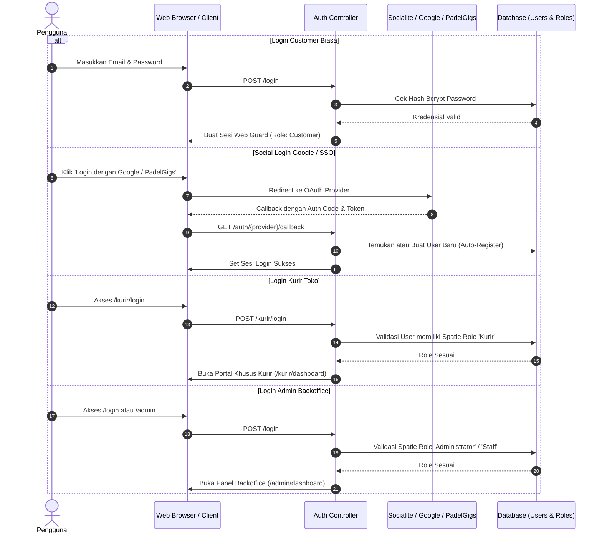
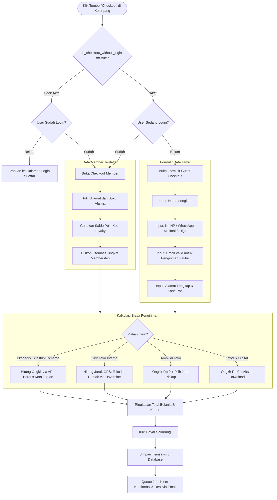
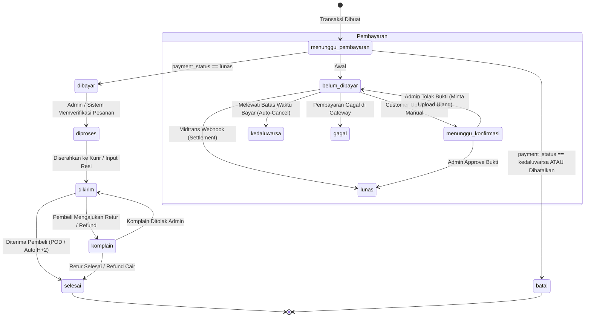
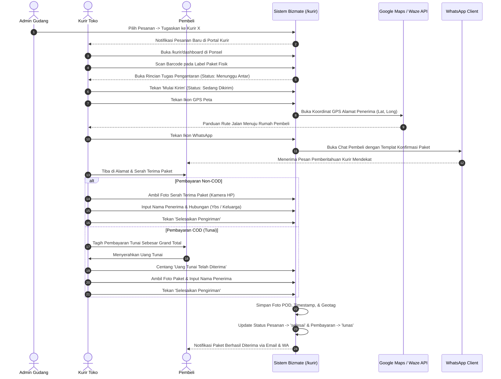
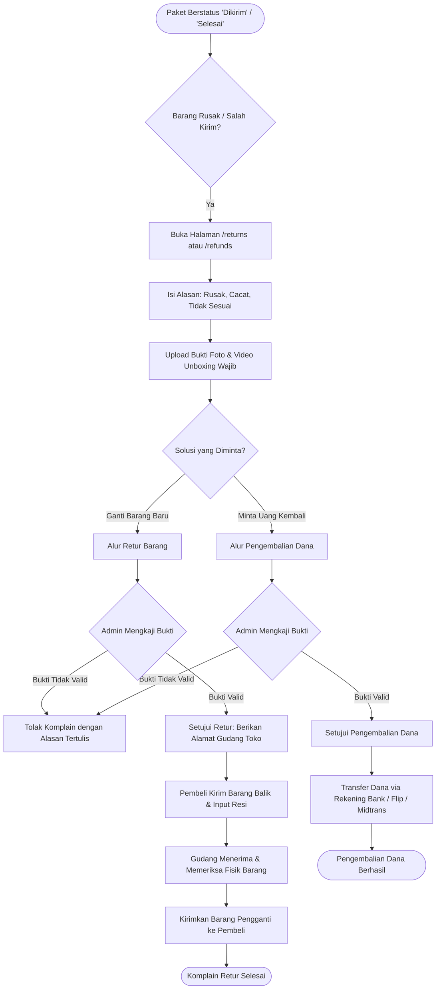
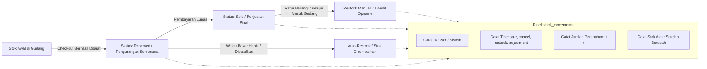
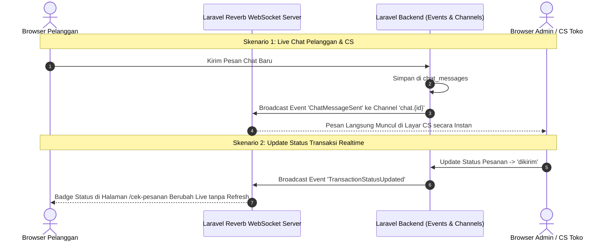

# 🔄 Skema Alur Kerja Sistem Lengkap (End-to-End System Workflow)

Dokumen ini memetakan seluruh skema alur proses bisnis (*business workflow*), diagram alir (*flowcharts*), diagram sekuens (*sequence diagrams*), serta mesin status (*state machines*) pada sistem e-commerce **Bizmate**.

---

## 1. Peta Alur Arsitektur Tingkat Tinggi (*High-Level Workflow*)

---

## 2. Alur Autentikasi & Manajemen Sesi

Sistem mendukung 4 gerbang masuk otentikasi yang aman dan terisolasi:

---

## 3. Alur Checkout Detail: Tamu (*Guest*) vs Member Terdaftar

---

## 4. Alur Lifecycle Pembayaran & State Machine

Status pesanan dikelola melalui kombinasi dua kolom status pada tabel `transactions`: **`status`** (alur fisik pesanan) dan **`payment_status`** (alur finansial pembayaran).

### Tabel Matriks Perubahan Status (*State Transition Table*)

| Dari Status | Ke Status | Pemicu (*Trigger*) | Aksi Sistem Otomatis |
|---|---|---|---|
| `menunggu_pembayaran` | `dibayar` | Webhook Midtrans `settlement` ATAU Admin setujui bukti manual | Kirim email nota pembayaran, potong stok mutasi, kirim event broadcast Reverb |
| `menunggu_pembayaran` | `batal` | Scheduled command cron mengecek pesanan expired (> 24 jam) | Kembalikan kuota voucher, kembalikan koin yang terpakai, kembalikan stok |
| `dibayar` | `diproses` | Admin menekan tombol "Proses Pesanan" | Status berpindah ke antrean gudang untuk dicetak label packing slip-nya |
| `diproses` | `dikirim` | Admin menugaskan kurir internal ATAU menginput nomor resi ekspedisi | Kirim email pemberitahuan resi kurir beserta link pelacakan paket live |
| `dikirim` | `selesai` | Kurir upload foto POD berhasil ATAU pembeli klik "Pesanan Diterima" | Cairkan koin cashback reward, akumulasi total belanja untuk naik level VIP |
| `dikirim` | `komplain` | Pembeli mengajukan komplain barang rusak / tidak lengkap | Tahan pelepasan dana, buat tiket di menu Retur/Refund admin |

---

## 5. Alur Penugasan & Pengantaran Kurir Toko (*Internal Fleet Flow*)

---

## 6. Alur Retur Barang & Pengembalian Dana (*Return & Refund Flow*)

---

## 7. Alur Pengurangan & Pengembalian Stok (*Stock Movements Cycle*)

Stok produk dijaga dengan akurasi mutlak untuk mencegah situasi *overselling* (terjual melebihi stok yang ada):

---

## 8. Alur Siaran Real-Time (*WebSockets Event Flow*)

Menggunakan **Laravel Reverb** untuk pengalaman reaktif tanpa *polling* berkala:

