# 🗄️ Arsitektur & Skema Database Lengkap (Database Schema & ERD)

Dokumen ini memuat dokumentasi arsitektur database, diagram relasi entitas (*Entity Relationship Diagram - ERD*), indeks performa, serta kamus data lengkap untuk lebih dari 40 tabel yang mendukung operasional platform **Bizmate**.

---

## 1. Diagram Relasi Entitas Menyeluruh (*Complete ERD*)

```mermaid
erDiagram
    %% ================= ENTITAS INTI PENGGUNA =================
    USERS ||--o{ CUSTOMER_ADDRESSES : "memiliki buku alamat"
    USERS ||--o{ CUSTOMER_BANK_ACCOUNTS : "memiliki rekening pencairan"
    USERS ||--o{ CARTS : "memiliki keranjang"
    USERS ||--o{ TRANSACTIONS : "membuat pesanan"
    USERS ||--o{ CHATS : "terlibat obrolan"
    USERS ||--o{ CUSTOMER_MEMBERSHIPS : "memiliki level VIP"
    USERS ||--o{ COIN_HISTORIES : "riwayat saldo koin"
    USERS ||--o{ PRODUCT_REVIEWS : "menulis ulasan"
    USERS ||--o{ SELLER_AD_WALLETS : "memiliki dompet iklan"
    USERS ||--o{ TRANSACTIONS : "bertindak sebagai kurir internal"

    %% ================= ENTITAS KATALOG & PRODUK =================
    CATEGORIES ||--o{ PRODUCTS : "mengelompokkan"
    BRANDS ||--o{ PRODUCTS : "memproduksi"
    
    PRODUCTS ||--|| PRODUCT_PRICES : "harga master"
    PRODUCTS ||--|| PRODUCT_STOCKS : "stok master"
    PRODUCTS ||--o{ PRODUCT_IMAGES : "galeri foto"
    PRODUCTS ||--o{ PRODUCT_VARIANTS : "memiliki kombinasi varian"
    PRODUCTS ||--o{ PRODUCT_TIER_PRICES : "skema harga grosir"
    PRODUCTS ||--o{ PRODUCT_REVIEWS : "menerima review"
    PRODUCTS ||--o{ CART_ITEMS : "dimasukkan ke keranjang"
    PRODUCTS ||--o{ TRANSACTION_ITEMS : "dijual dalam transaksi"
    PRODUCTS ||--o{ PRODUCT_ADS : "dipromosikan bersponsor"
    PRODUCTS ||--o{ PRODUCT_LISTING_PAYMENTS : "biaya listing"

    PRODUCT_VARIANTS ||--|| PRODUCT_PRICES : "harga varian"
    PRODUCT_VARIANTS ||--|| PRODUCT_STOCKS : "stok varian"
    PRODUCT_VARIANTS ||--o{ CART_ITEMS : "item varian di keranjang"
    PRODUCT_VARIANTS ||--o{ TRANSACTION_ITEMS : "item varian di transaksi"

    %% ================= ENTITAS TRANSAKSI & PEMENUHAN =================
    PAYMENT_METHODS ||--o{ TRANSACTIONS : "digunakan untuk bayar"
    COURIERS ||--o{ TRANSACTIONS : "mengirim paket"
    
    TRANSACTIONS ||--|{ TRANSACTION_ITEMS : "berisi rincian item"
    TRANSACTIONS ||--o| TRANSACTION_PAYMENTS : "memiliki bukti bayar"
    TRANSACTIONS ||--o{ TRANSACTION_STATUS_HISTORIES : "riwayat alur status"
    TRANSACTIONS ||--o| RETURNS : "pengajuan retur barang"
    TRANSACTIONS ||--o| REFUND_REQUESTS : "pengajuan pengembalian dana"

    %% ================= ENTITAS LOGISTIK & RETUR =================
    RETURNS ||--|{ RETURN_ITEMS : "item yang diretur"
    RETURNS ||--o{ RETURN_MEDIA : "bukti foto/video unboxing"

    %% ================= ENTITAS PROMOSI & MEMBERSHIP =================
    PROMOTIONS ||--o{ PROMOTION_ITEMS : "daftar produk promo"
    MEMBERSHIP_LEVELS ||--o{ CUSTOMER_MEMBERSHIPS : "menentukan tingkatan"
    MEMBERSHIP_LEVELS ||--o{ MEMBERSHIP_BENEFITS : "daftar fasilitas"
    MEMBERSHIP_LEVELS ||--o{ MEMBERSHIP_CASHBACKS : "aturan cashback"
    MEMBERSHIP_LEVELS ||--o{ MEMBERSHIP_POINTS : "rasio poin"
    MEMBERSHIP_LEVELS ||--o{ MEMBERSHIP_VOUCHERS : "kupon bulanan"

    %% ================= ENTITAS KOMUNIKASI & AUDIT =================
    CHATS ||--|{ CHAT_MESSAGES : "pesan obrolan"
    CHAT_STICKERS ||--o{ CHAT_MESSAGES : "stiker yang dikirim"
    USERS ||--o{ STOCK_MOVEMENTS : "mencatat audit stok"
    SELLER_AD_WALLETS ||--o{ SELLER_AD_TRANSACTIONS : "mutasi saldo iklan"
    PRODUCT_ADS ||--o{ PRODUCT_AD_CLICKS : "log klik iklan"
```

---

## 2. Kamus Data Tabel Utama (*Data Dictionary*)

### A. Modul Pengguna & Akun (*Users & Auth*)

#### 1. Tabel `users`
Tabel sentral seluruh akun: Customer, Kurir, Administrator, dan Seller.
| Nama Kolom | Tipe Data | Nullable | Default | Deskripsi & Catatan Bisnis |
|---|---|:---:|:---:|---|
| `id` | `BIGINT UNSIGNED` | NO | Auto PK | Pengenal unik pengguna. |
| `name` | `VARCHAR(255)` | NO | - | Nama lengkap pengguna. |
| `email` | `VARCHAR(255)` | NO | Unique | Alamat surel aktif (digunakan untuk login & faktur). |
| `phone_number` | `VARCHAR(20)` | YES | NULL | Nomor seluler / WhatsApp untuk konfirmasi pengiriman kurir. |
| `password` | `VARCHAR(255)` | YES | NULL | Hash Bcrypt kata sandi (Nullable jika login via Google/SSO). |
| `google_id` | `VARCHAR(255)` | YES | NULL | ID unik akun Google OAuth. |
| `padelgigs_id`| `VARCHAR(255)` | YES | NULL | ID unik integrasi SSO komunitas PadelGigs. |
| `coins_balance`| `INT UNSIGNED` | NO | `0` | Saldo koin loyalty yang dapat dipakai memotong pembayaran. |
| `is_active` | `BOOLEAN` | NO | `true` | Status aktivasi akun (dapat dinonaktifkan admin). |
| `is_seller` | `BOOLEAN` | NO | `false` | Menandai user memiliki akses toko penjual. |
| `last_active_at`| `TIMESTAMP` | YES | NULL | Waktu terakhir user beraktivitas online. |
| `created_at` | `TIMESTAMP` | YES | NULL | Waktu akun didaftarkan. |

#### 2. Tabel `customer_addresses`
Buku alamat pengiriman pembeli untuk penentuan kurir otomatis.
| Nama Kolom | Tipe Data | Nullable | Default | Deskripsi & Catatan Bisnis |
|---|---|:---:|:---:|---|
| `id` | `BIGINT UNSIGNED` | NO | Auto PK | Pengenal unik alamat. |
| `user_id` | `BIGINT UNSIGNED` | NO | FK | Terhubung ke `users.id`. |
| `label` | `VARCHAR(50)` | YES | `'Rumah'` | Label alamat (misal: Rumah, Kantor, Kos, Toko). |
| `receiver_name`| `VARCHAR(255)` | NO | - | Nama penerima paket di lokasi. |
| `phone_number`| `VARCHAR(20)` | NO | - | Nomor kontak aktif penerima paket. |
| `full_address`| `TEXT` | NO | - | Alamat detail (jalan, blok, nomor, patokan khusus). |
| `province_name`| `VARCHAR(100)`| YES | NULL | Nama provinsi pengiriman. |
| `regency_name`| `VARCHAR(100)` | YES | NULL | Nama kota / kabupaten. |
| `district_name`| `VARCHAR(100)`| YES | NULL | Nama kecamatan. |
| `village_name`| `VARCHAR(100)` | YES | NULL | Nama kelurahan / desa. |
| `postal_code` | `VARCHAR(10)` | NO | - | Kode pos lokasi. |
| `latitude` | `DECIMAL(10,8)`| YES | NULL | Koordinat latitude peta (Wajib untuk Kurir Toko). |
| `longitude` | `DECIMAL(11,8)`| YES | NULL | Koordinat longitude peta (Wajib untuk Kurir Toko). |
| `biteship_area_id`| `VARCHAR(100)`| YES | NULL | ID area pengiriman terstandarisasi Biteship API. |
| `is_primary` | `BOOLEAN` | NO | `false` | Penanda alamat default saat checkout. |

---

### B. Modul Katalog Produk & Inventaris (*Products & Stocks*)

#### 3. Tabel `products`
Katalog induk seluruh produk yang dipasarkan.
| Nama Kolom | Tipe Data | Nullable | Default | Deskripsi & Catatan Bisnis |
|---|---|:---:|:---:|---|
| `id` | `BIGINT UNSIGNED` | NO | Auto PK | Pengenal unik produk. |
| `category_id` | `BIGINT UNSIGNED` | YES | FK | Relasi kategori utama (`categories.id`). |
| `brand_id` | `BIGINT UNSIGNED` | YES | FK | Relasi merek resmi (`brands.id`). |
| `user_id` | `BIGINT UNSIGNED` | YES | FK | ID penjual pemilik produk (jika multi-vendor). |
| `name` | `VARCHAR(255)` | NO | - | Judul nama barang komersial. |
| `slug` | `VARCHAR(255)` | NO | Index | URL ramah mesin pencari (SEO slug). |
| `sku` | `VARCHAR(100)` | YES | Unique | *Stock Keeping Unit* induk produk. |
| `summary` | `VARCHAR(500)` | YES | NULL | Cuplikan singkat produk untuk kartu beranda. |
| `description` | `LONGTEXT` | YES | NULL | Deskripsi detail spesifikasi (HTML Rich Text). |
| `condition` | `ENUM` | NO | `'new'` | Pilihan kondisi: `'new'` (baru) atau `'used'` (bekas). |
| `weight_grams`| `INT UNSIGNED` | NO | `1000` | Bobot produk dalam satuan gram (untuk ongkir). |
| `length_cm`, `width_cm`, `height_cm` | `INT` | YES | NULL | Dimensi paket untuk perhitungan ongkir volumetrik. |
| `is_digital` | `BOOLEAN` | NO | `false` | True = tanpa ongkos kirim (produk file/lisensi). |
| `is_promo` | `BOOLEAN` | NO | `false` | True = sedang dalam periode diskon aktif. |
| `promo_price` | `DECIMAL(12,2)`| YES | NULL | Nilai harga promo jika aktif. |
| `has_variants`| `BOOLEAN` | NO | `false` | True = memiliki variasi warna/ukuran bersarang. |
| `is_featured` | `BOOLEAN` | NO | `false` | True = ditampilkan pada sorotan utama homepage. |
| `model_3d_path`| `VARCHAR(255)`| YES | NULL | Path file model 3D AR (`.glb` / `.usdz`). |
| `video_url` | `VARCHAR(255)` | YES | NULL | URL video showcase produk (YouTube / MP4). |
| `order_column`| `INT` | NO | `0` | Urutan penataan manual produk di katalog. |

#### 4. Tabel `product_variants`
Menampung variasi kombinasi spesifik suatu produk (misal: "Merah - XL").
| Nama Kolom | Tipe Data | Nullable | Default | Deskripsi & Catatan Bisnis |
|---|---|:---:|:---:|---|
| `id` | `BIGINT UNSIGNED` | NO | Auto PK | Pengenal unik varian. |
| `product_id` | `BIGINT UNSIGNED` | NO | FK | Terhubung ke `products.id`. |
| `name` | `VARCHAR(255)` | NO | - | Nama varian (contoh: "Hitam Glossy - Size 42"). |
| `sku` | `VARCHAR(100)` | YES | Unique | Kode SKU khusus varian bersangkutan. |
| `weight_grams`| `INT UNSIGNED` | YES | NULL | Berat khusus varian (jika berbeda dari induk). |

#### 5. Tabel `product_prices` & `product_stocks`
Arsitektur terisolasi untuk harga dan inventaris:
- **`product_prices`**:
  - `priceable_id` & `priceable_type` (Polymorphic): Terhubung ke `Product` atau `ProductVariant`.
  - `price` (`DECIMAL(12,2)`): Harga jual ritel ke pelanggan.
  - `cost` (`DECIMAL(12,2)`): Harga Pokok Penjualan (HPP / Biaya Modal) untuk audit laba bersih.
- **`product_stocks`**:
  - `stockable_id` & `stockable_type` (Polymorphic): Terhubung ke `Product` atau `ProductVariant`.
  - `stock` (`INT`): Kuantitas fisik barang yang tersedia di gudang.
  - `is_unlimited` (`BOOLEAN`): Jika true, stok tidak pernah habis (misal: produk digital).

#### 6. Tabel `stock_movements`
Buku besar audit mutasi pergerakan inventaris anti-selisih.
| Nama Kolom | Tipe Data | Nullable | Default | Deskripsi & Catatan Bisnis |
|---|---|:---:|:---:|---|
| `id` | `BIGINT UNSIGNED` | NO | Auto PK | Pengenal unik mutasi. |
| `product_id` | `BIGINT UNSIGNED` | NO | FK | ID produk yang bermutasi. |
| `product_variant_id`| `BIGINT UNSIGNED`| YES | FK | ID varian produk (jika bertipe varian). |
| `user_id` | `BIGINT UNSIGNED` | YES | FK | ID user yang melakukan mutasi (Admin / Sistem). |
| `type` | `VARCHAR(50)` | NO | - | `'sale'`, `'cancellation'`, `'restock'`, `'adjustment'`, `'return'`. |
| `quantity` | `INT` | NO | - | Jumlah unit bertambah (+) atau berkurang (-). |
| `current_stock`| `INT` | NO | - | Saldo stok fisik setelah operasi terjadi. |
| `notes` | `VARCHAR(255)` | YES | NULL | Alasan mutasi (misal: "Pesanan TRX-001 Lunas"). |

---

### C. Modul Transaksi & Finansial (*Transactions & Orders*)

#### 7. Tabel `transactions`
Jantung operasional seluruh pesanan e-commerce.
| Nama Kolom | Tipe Data | Nullable | Default | Deskripsi & Catatan Bisnis |
|---|---|:---:|:---:|---|
| `id` | `BIGINT UNSIGNED` | NO | Auto PK | Pengenal unik transaksi. |
| `transaction_number`| `VARCHAR(50)` | NO | Unique | Nomor faktur publik (format: `TRX-YYYYMMDD-XXXX`). |
| `user_id` | `BIGINT UNSIGNED` | NO | FK | ID pembeli (termasuk akun tamu yang di-generate). |
| `customer_name`| `VARCHAR(255)` | NO | - | Snapshot nama pembeli saat checkout. |
| `customer_phone`| `VARCHAR(20)` | NO | - | Snapshot nomor HP pembeli. |
| `customer_email`| `VARCHAR(255)` | NO | - | Snapshot email pembeli. |
| `customer_address_id`| `BIGINT UNSIGNED`| YES | FK | Alamat yang digunakan (NULL jika Self-Pickup/Digital). |
| `payment_method_id`| `BIGINT UNSIGNED`| NO | FK | Metode pembayaran yang dipilih (`payment_methods.id`). |
| `subtotal` | `DECIMAL(12,2)`| NO | `0.00` | Total harga barang sebelum diskon & ongkir. |
| `shipping_fee` | `DECIMAL(12,2)`| NO | `0.00` | Biaya pengiriman logistik. |
| `application_fee`| `DECIMAL(12,2)`| NO | `0.00` | Biaya layanan / penanganan transaksi. |
| `additional_costs`| `JSON` | YES | NULL | Biaya tambahan terperinci (Asuransi, Packing kayu). |
| `discount_amount`| `DECIMAL(12,2)`| NO | `0.00` | Total potongan harga dari voucher belanja. |
| `coins_redeemed`| `INT UNSIGNED` | NO | `0` | Nilai koin yang digunakan memotong bayar. |
| `grand_total` | `DECIMAL(12,2)`| NO | `0.00` | Nilai tagihan final yang wajib dibayar. |
| `status` | `VARCHAR(50)` | NO | `'menunggu_pembayaran'` | `'menunggu_pembayaran'`, `'dibayar'`, `'diproses'`, `'dikirim'`, `'selesai'`, `'batal'`. |
| `payment_status`| `VARCHAR(50)` | NO | `'belum_dibayar'` | `'belum_dibayar'`, `'menunggu_konfirmasi'`, `'lunas'`, `'kedaluwarsa'`, `'gagal'`. |
| `shipping_courier`| `VARCHAR(50)` | NO | - | Kode kurir: `'jne'`, `'jnt'`, `'store_courier'`, `'self_pickup'`, `'digital'`. |
| `shipping_service`| `VARCHAR(50)` | YES | NULL | Layanan ekspedisi: `'REG'`, `'YES'`, `'Instant'`. |
| `tracking_number`| `VARCHAR(100)` | YES | Index | Nomor resi resmi ekspedisi atau kurir. |
| `courier_user_id`| `BIGINT UNSIGNED`| YES | FK | ID armada kurir toko yang ditugaskan (`users.id`). |
| `delivery_arrived_at`| `TIMESTAMP`| YES | NULL | Waktu fisik kurir tiba di lokasi pelanggan. |
| `delivery_photos`| `JSON` | YES | NULL | Array path foto bukti serah terima paket kurir (POD). |
| `pickup_at` | `TIMESTAMP` | YES | NULL | Jadwal waktu pengambilan jika Self-Pickup. |
| `notes` | `TEXT` | YES | NULL | Catatan khusus dari pembeli untuk penjual/kurir. |

#### 8. Tabel `transaction_items`
Snapshot produk yang dipesan saat transaksi terjadi.
| Nama Kolom | Tipe Data | Nullable | Default | Deskripsi & Catatan Bisnis |
|---|---|:---:|:---:|---|
| `id` | `BIGINT UNSIGNED` | NO | Auto PK | Pengenal unik baris item. |
| `transaction_id`| `BIGINT UNSIGNED`| NO | FK | Terhubung ke `transactions.id`. |
| `product_id` | `BIGINT UNSIGNED` | NO | FK | ID produk asal. |
| `product_variant_id`| `BIGINT UNSIGNED`| YES | FK | ID varian produk (jika memilih varian). |
| `quantity` | `INT UNSIGNED` | NO | `1` | Jumlah kuantitas yang dibeli. |
| `price` | `DECIMAL(12,2)`| NO | - | Harga jual satuan saat pesanan dibuat. |
| `cost_price` | `DECIMAL(12,2)`| NO | `0.00` | HPP satuan saat checkout untuk analisis laba kotor. |
| `subtotal` | `DECIMAL(12,2)`| NO | - | `quantity * price`. |
| `notes` | `VARCHAR(255)` | YES | NULL | Catatan kustom per barang. |

---

### D. Modul Komplain, Retur & Pengembalian Dana (*Returns & Refunds*)

#### 9. Tabel `returns` & `return_items` & `return_media`
- **`returns`**:
  - `transaction_id`: ID transaksi yang dikomplain.
  - `status`: `'pending'`, `'approved'`, `'rejected'`, `'shipping'`, `'received'`, `'completed'`.
  - `reason`: Alasan komplain retur.
  - `return_tracking_number`: Nomor resi pengiriman barang balik ke toko dari pembeli.
- **`return_items`**: Menyimpan daftar produk dan jumlah unit yang ingin diretur pembeli.
- **`return_media`**: Menyimpan URL file foto dan video unboxing paket sebagai bukti fisik kerusakan.

#### 10. Tabel `refund_requests`
- Mencatat permintaan pencairan dana kembali: `transaction_id`, `amount`, `bank_name`, `account_number`, `account_name`, status persetujuan, dan bukti transfer pencairan dari finance.

---

### E. Modul Program Promosi, Loyalty & Membership

#### 11. Tabel `membership_levels` & `customer_memberships`
- **`membership_levels`**: Menyimpan konfigurasi level (Classic, Bronze, Silver, Gold, Platinum), batas belanja akumulasi, persentase diskon instan checkout (`apply_discount_at_checkout`), dan kuota voucher.
- **`customer_memberships`**: Menghubungkan setiap pengguna ke level aktif mereka serta tanggal kedaluwarsa periode membership.

#### 12. Tabel `coin_histories`
- Mencatat keluar masuk koin loyalitas: `user_id`, `amount` (+/-), `type` (`'earned_from_order'`, `'redeemed_at_checkout'`, `'manual_adjustment'`), dan referensi transaksi.

---

### F. Modul Multi-Vendor & Seller Ads (Mode Marketplace)

#### 13. Tabel `product_ads` & `seller_ad_wallets`
- **`seller_ad_wallets`**: Saldo uang iklan milik toko penjual (`balance`).
- **`product_ads`**: Konfigurasi promosi produk (penempatan: Beranda, Search, Produk Serupa; model: CPC / CPM; anggaran harian; status aktif).
- **`product_ad_clicks`**: Catatan riwayat klik iklan pengunjung untuk mencegah kecurangan *click-fraud*.

---

## 3. Strategi Pengindeksan & Optimalisasi Kueri (*Performance Indexes*)

Untuk menjaga kecepatan respon kueri di bawah 50ms saat volume transaksi mencapai ratusan ribu baris:

1. **Indeks Komposit Transaksi**:
   - `INDEX (status, created_at)`: Mempercepat filter daftar pesanan di dashboard admin.
   - `INDEX (user_id, status)`: Mempercepat tab riwayat pesanan pelanggan.
   - `INDEX (courier_user_id, status)`: Mengoptimalkan pemuatan tugas kurir toko di portal `/kurir`.
2. **Indeks Komposit Katalog**:
   - `INDEX (category_id, is_active, created_at)`: Mempercepat browsing etalase kategori.
   - `INDEX (brand_id, is_active)`: Mempercepat filter berdasarkan merek.
3. **Indeks Tracking & Pencarian Cepat**:
   - `INDEX (transaction_number)` & `INDEX (tracking_number)`: Pencarian instan halaman `/cek-pesanan`.

