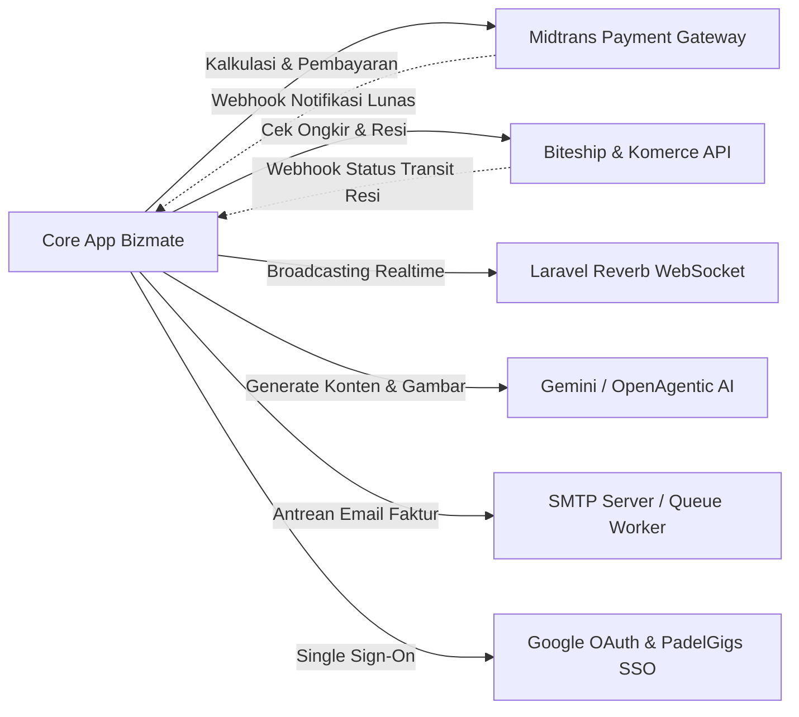
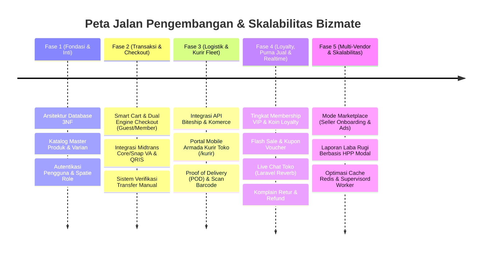

# 🔌 Integrasi Pihak Ketiga, Keamanan & Roadmap Implementasi

Dokumen ini menguraikan arsitektur integrasi API eksternal (*third-party services*), penanganan webhook, mitigasi keamanan transaksi & konkurensi stok, serta peta jalan (*roadmap*) pengembangan berkelanjutan aplikasi **Bizmate**.

---

## 1. Arsitektur Integrasi API Pihak Ketiga (*Third-Party Integrations*)



---

### A. Integrasi Payment Gateway (Midtrans Core & Snap API)
1. **Mekanisme Permintaan Pembayaran**:
   - Sistem backend melakukan enkripsi payload transaksi dan membuat tagihan unik melalui Midtrans API.
   - Mengembalikan Token Snap atau nomor Virtual Account (BCA, Mandiri, BNI, BRI, Permata) serta QRIS Payload.
2. **Penanganan Webhook Notifikasi (`POST /api/webhooks/midtrans`)**:
   - **Verifikasi Keamanan Signature Hash**:
     $$\text{Signature} = \text{SHA512}(\text{order\_id} + \text{status\_code} + \text{gross\_amount} + \text{ServerKey})$$
     Permintaan webhook yang gagal mencocokkan signature akan ditolak seketika (`HTTP 403 Forbidden`) untuk mencegah pemalsuan pembayaran (*spoofing*).
   - **Pemetaan Status**:
     - `settlement` / `capture` (accept) $\rightarrow$ `payment_status = 'lunas'`, `status = 'dibayar'`.
     - `pending` $\rightarrow$ `payment_status = 'belum_dibayar'`.
     - `expire` $\rightarrow$ `payment_status = 'kedaluwarsa'`, `status = 'batal'`.
     - `cancel` / `deny` $\rightarrow$ `payment_status = 'gagal'`, `status = 'batal'`.

---

### B. Integrasi Logistik & Resi Ekspedisi (Biteship & Komerce API)
1. **Standardisasi Area Pengiriman**:
   - Saat pembeli menginput alamat atau memilih kecamatan/kota, sistem melakukan pencarian via Biteship API untuk mendapatkan `biteship_area_id` yang valid.
2. **Kalkulasi Tarif Real-time**:
   - Backend mengirimkan berat gabungan (`total_weight_grams`), kode asal gudang toko, dan ID area tujuan.
   - Menghasilkan daftar kurir (JNE, J&T, SiCepat, Anteraja, Ninja Express) lengkap dengan estimasi hari tiba (ETD) dan tarif ongkir resmi.
3. **Webhook Pelacakan Resi Otomatis (`POST /api/webhooks/biteship`)**:
   - Event `order.waybill_updated`, `order.delivered` memperbarui data tabel `transactions` dan tabel riwayat status secara otomatis tanpa intervensi manual staf admin.

---

### C. Integrasi Kecerdasan Buatan (Gemini & OpenAgentic AI)
- **AI Copywriting Produk**: Memproses atribut produk (kategori, nama, bahan, target pengguna) dan mengembalikan deskripsi terstruktur berformat HTML/Markdown dengan teknik *copywriting* AIDA (*Attention, Interest, Desire, Action*).
- **Reverse Image Lookup**: Membantu staf admin menemukan katalog spesifikasi pabrikan dari foto produk mentah.

---

## 2. Mitigasi Keamanan & Konkurensi Tingkat Tinggi (*Concurrency & Anti-Fraud*)

### A. Perlindungan Selisih Stok Saat Flash Sale (*Pessimistic Locking*)
Ketika ribuan pengguna melakukan checkout produk yang sama secara bersamaan, sistem menerapkan transaksi database dengan kunci pesimistik (*pessimistic row locking*):

```php
DB::transaction(function () use ($productId, $quantity) {
    // Mengunci baris stok produk sampai transaksi selesai dieksekusi
    $stock = ProductStock::where('product_id', $productId)->lockForUpdate()->first();
    
    if ($stock->stock < $quantity) {
        throw new InsufficientStockException("Maaf, stok barang tidak mencukupi.");
    }
    
    $stock->decrement('stock', $quantity);
    
    // Catat mutasi inventaris
    StockMovement::create([
        'product_id' => $productId,
        'quantity' => -$quantity,
        'current_stock' => $stock->stock,
        'type' => 'sale',
    ]);
});
```

### B. Validasi Anti-Fraud Pengantaran Kurir Toko (*Proof of Delivery / POD*)
- Kurir wajib mengaktifkan izin GPS pada peramban ponsel. Koordinat lokasi fisik saat menekan tombol "Selesaikan Pengiriman" diverifikasi berada dalam radius wajar dari alamat tujuan.
- Foto serah terima paket disimpan terenkripsi dengan penanda waktu (*timestamp watermark*) dan nama penerima fisik.

### C. Pembatasan Laju Akses (*Rate Limiting*)
- Endpoint sensitif seperti `POST /checkout` dan `POST /cek-pesanan` dilindungi oleh Laravel Rate Limiter (maksimal 10 percobaan per menit per IP) untuk mencegah serangan *brute force* dan *credential stuffing*.

---

## 3. Peta Jalan Pengembangan & Rilis (*Implementation Roadmap*)



### Rincian Fase:
1. **Fase 1: Inti Sistem & Manajemen Katalog (Selesai & Teruji)**:
   - Struktur database 40+ tabel terindeks lengkap.
   - CRUD Produk dengan dukungan varian bersarang, media video Plyr, dan 3D AR Model Viewer.
2. **Fase 2: Mesin Transaksi & Checkout Ganda (Selesai & Teruji)**:
   - Dukungan guest checkout tanpa login (`is_checkout_without_login`).
   - Integrasi payment gateway otomatis dan transfer manual dengan upload bukti.
3. **Fase 3: Logistik & Armada Pengiriman Mandiri (Selesai & Operasional)**:
   - Kalkulasi ongkir otomatis via API ekspedisi.
   - Portal kurir toko internal dengan fitur rute GPS, kontak WhatsApp instan, pemindai barcode, dan POD anti-fraud.
4. **Fase 4: Program Loyalitas, Layanan Pelanggan & Retur (Selesai & Berjalan)**:
   - Sistem membership VIP (Classic hingga Platinum) dengan diskon otomatis.
   - Live chat real-time dengan WebSockets (Reverb).
   - Penanganan retur barang rusak dengan bukti video unboxing.
5. **Fase 5: Monetisasi Seller & Analitik Lanjutan (Ekspansi Bisnis)**:
   - Pengaktifan mode multi-vendor (`IS_SELLER=true`).
   - Penagihan listing produk berbayar dan iklan produk bersponsor (*Seller Ads Wallet*).
   - Laporan analitik keuangan laba rugi otomatis (Omset - HPP = Laba Kotor).

---

## 4. Strategi Pengujian Otomatis (*Automated Testing Suite*)

Sistem dilindungi oleh rangkaian pengujian otomatis menggunakan **Pest PHP 4**:

- **Feature Tests**: Menguji alur registrasi, penambahan produk ke keranjang, skenario checkout guest vs member, pemrosesan webhook Midtrans, dan pembaruan tugas kurir.
- **Unit Tests**: Menguji keakuratan rumus perhitungan jarak Haversine untuk tarif kurir toko, kalkulasi diskon tier pricing, dan integritas pengurangan stok mutasi.
- **Role & Authorization Tests**: Memastikan kurir tidak dapat mengakses menu admin, dan pelanggan biasa tidak dapat mengakses portal kurir.
- **Eksekusi Pengujian Cepat**:
  ```bash
  php artisan test --compact
  ```

