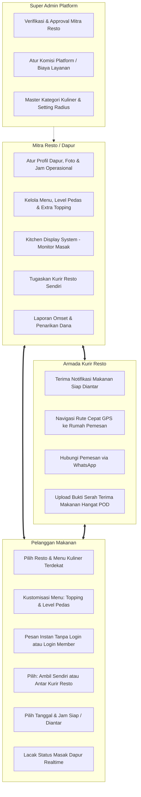

# ⚙️ Arsitektur Variabel Lingkungan & Analisis Fitur Peran Resto (FoodPick Specification)

Dokumen ini menguraikan bagaimana variabel lingkungan (`.env`) mengendalikan perilaku aplikasi, adaptasi terminologi (*wording translation*), serta spesifikasi fungsional untuk setiap peran dalam ekosistem **FoodPick**.

---

## 1. Adaptasi Bahasa & Terminologi (*Dynamic Wording Mapping*)

Saat `IS_FOODPICK=true`, sistem secara otomatis mengadaptasi terminologi antarmuka dari bahasa e-commerce ritel umum menjadi bahasa kuliner yang ramah bagi pelanggan dan pemilik dapur:

| Konteks Sistem | Mode E-Commerce Standar (`IS_FOODPICK=false`) | Mode Kuliner & Resto (`IS_FOODPICK=true`) |
|---|---|---|
| **Etalase & Katalog** | Produk & Barang Ritel | **Menu Makanan & Minuman** |
| **Penyedia / Vendor** | Toko / Seller / Merchant | **Resto / Dapur / Mitra Kuliner** |
| **Grup Katalog** | Kategori Produk | **Kategori Kuliner** (Makanan Utama, Snack, Minuman, Paket Hemat) |
| **Variasi Item** | Warna, Ukuran, Berat | **Ukuran Porsi, Level Pedas, Pilihan Nasi** |
| **Opsi Tambahan** | Opsi Varian Tambahan | **Ekstra Topping & Tambahan Lauk (Add-ons)** |
| **Catatan Item** | Catatan Varian | **Catatan Khusus Koki** (*"Jangan pakai daun bawang", "Sambal dipisah"*) |
| **Inventaris** | Jumlah Stok Fisik | **Ketersediaan Menu** (*Tersedia* / *Habis Hari Ini*) |
| **Waktu Pengerjaan** | - | **Estimasi Waktu Memasak** (*15 - 30 Menit*) |
| **Ambil Sendiri** | Ambil di Toko (*Self-Pickup*) | **Ambil Sendiri di Resto** (*Takeaway / Bungkus / Dine-In*) |
| **Waktu Pengambilan** | Slot Waktu Toko | **Estimasi Jam Makanan Siap Diambil** |
| **Kurir Toko** | Kurir Toko Internal | **Kurir Resto / Pengantaran Resto Sendiri** |
| **Waktu Pengantaran** | Waktu Kirim Toko | **Jadwal Pengantaran Makanan ke Alamat** |
| **Kurir Ekspedisi** | JNE, J&T, SiCepat, Anteraja | **SEMBUNYIKAN / OTOMATIS NONAKTIF** |
| **Status Pemrosesan** | Paket Sedang Dikemas | **Pesanan Sedang Dimasak di Dapur** |
| **Status Siap Kirim** | Paket Siap Diserahkan | **Makanan Selesai Dimasak & Siap Diambil / Diantar** |

---

## 2. Matriks Fitur Per Peran Pengguna (*Role Features Matrix*)



---

## 3. Spesifikasi Fungsional Peran Resto / Dapur (*Resto Merchant*)

Mitra Resto mengelola operasional restorannya melalui dashboard khusus (`/resto` atau `/admin` saat berperan sebagai Seller):

### A. Manajemen Profil Resto & Jadwal Buka-Tutup
1. **Identitas Dapur**:
   - Nama Resto (contoh: *"Bebek Sinjay Cabang Sudirman"*).
   - Kategori Kuliner: Pilihan kategori utama (misal: Aneka Nasi, Kopi & Minuman, Cepat Saji, Jajanan Pasar).
   - Foto Profil Logo Resto dan Foto Banner Etalase.
   - Titik Pin Koordinat GPS Dapur (`latitude`, `longitude`) untuk kalkulasi jarak radius kurir resto ke rumah pembeli.
2. **Jadwal Operasional Harian**:
   - Jam Buka dan Jam Tutup per hari (Senin s/d Minggu).
   - **Toggle Darurat "Tutup Sementara"**: Sakelar darurat jika dapur kelebihan muatan pesanan (*kitchen overload*) agar resto tidak menerima pesanan baru sementara waktu.
3. **Metode Pembayaran Mandiri Khusus Resto (Per-Resto Payment Independence)**:
   - Dapur/resto mengelola saluran penerimaan dana langsung melalui pengaturan `/admin/resto-profile`:
     - **Bayar di Tempat (COD / Kasir)**: Sakelar aktif/nonaktif serta instruksi uang pas.
     - **Transfer Bank Langsung**: Pilihan nama bank (BCA, Mandiri, BRI, BNI, Bank Jatim, dll), nomor rekening resto, dan nama pemilik rekening.
     - **QRIS Resto Manual (Semua E-Wallet)**: Upload foto kode QRIS resto dan nama merchant terdaftar.
     - **Payment Gateway: WARIS QRIS Dinamis Resto**: Integrasi API URL, API Key, Webhook Secret, QRIS Code, dan Admin Fee dengan verifikasi webhook otomatis (`/api/webhooks/waris`) untuk notifikasi pelunasan instan secara otonom per-resto.
4. **Skema Tarif Kurir Resto & Jangkauan**:
   - Pilihan tipe tarif: **Tarif Flat** (sama rata per pengantaran) atau **Tarif Per Kilometer** (berdasarkan jarak GPS).
   - Biaya ongkos kirim dasar (contoh: Rp 10.000 flat atau Rp 2.500 / km).
   - Radius maksimal pengantaran kurir internal (contoh: maksimal 10 km).
   - Opsi ambang batas belanja untuk Gratis Ongkir Resto (contoh: belanja di atas Rp 75.000 gratis ongkir).
5. **Manajemen Armada Kurir Resto & Portal Kurir** (`/admin/courier-dispatch` & `/kurir/login`):
   - Dapur/resto dapat mendaftarkan kurir resto sendiri secara mandiri melalui modal *"Tambah Akun Kurir Resto"* di `/admin/courier-dispatch`.
   - Akun kurir terdaftar langsung memiliki akses ke **Portal Kurir** (`/kurir/login`) untuk mengklaim pengantaran, melihat rute GPS, dan update status serah terima makanan.
   - Penugasan kurir (*courier assignment*) dapat dilakukan langsung dari kartu pesanan di dashboard pengantaran.
   - **Penyelesaian Otomatis COD (*COD Auto-Settlement*)**: Ketika pesanan COD diserahkan (baik kasir resto pada *self-pickup* atau kurir resto pada *store courier*), sistem secara otomatis mengupdate `payment_status = paid` tanpa menggantungkan status pembayaran.

---

### B. Manajemen Menu Makanan & Minuman
1. **Atribut Menu Dasar**:
   - Nama Menu (contoh: *"Paket Nasi Ayam Geprek Keju"*).
   - Foto Menu menggugah selera (dengan fitur crop rasio 1:1).
   - Deskripsi bahan & cita rasa.
   - Harga Normal dan Harga Diskon Promo.
   - **Estimasi Waktu Memasak** (`prep_time_minutes`, misal: 15 menit) — digunakan untuk menghitung estimasi jam makanan siap diambil/diantar.
2. **Ketersediaan Menu (*Stock Toggle*)**:
   - Tombol cepat sakelar satu-klik: **Tersedia** (*Available*) vs **Habis Hari Ini** (*Sold Out*).
3. **Kustomisasi Menu Dinamis (Dynamic Menu Modifiers & Add-ons)**:
   - **Tanpa Default Hardcoded**: Kustomisasi varian menu tidak dibuat baku atau statis. Varian dan topping hanya muncul jika secara eksplisit dikonfigurasi per produk via URL `/admin/products/{id}/modifiers`.
   - **Grup Kustomisasi Fleksibel**: Dapur/resto dapat membuat grup kustomisasi bebas sesuai jenis kuliner (contoh: Level Pedas, Pilihan Nasi/Karbo, Jenis Kuah, Suhu Minuman, atau Ekstra Topping).
   - **Kaidah Validasi Pilihan**:
     - *Pilihan Tunggal Wajib* (`is_required = true, is_multiple = false`): Pembeli wajib memilih 1 opsi radio sebelum pesanan dimasukkan ke keranjang.
     - *Pilihan Tunggal Opsional* (`is_required = false, is_multiple = false`): Pembeli dapat memilih atau mengosongkan pilihan.
     - *Pilih Banyak / Multi-Select* (`is_multiple = true, max_selectable = N`): Pembeli dapat mencentang beberapa opsi hingga batas maksimum yang ditentukan resto.
   - **Tambahan Harga Dinamis**: Setiap item opsi memiliki nominal tambahan harga (`additional_price`) yang otomatis mengalkulasi total harga pesanan.
   - **Perilaku Menu Tanpa Modifier**: Produk kuliner yang belum memiliki kustomisasi di database disajikan secara standar tanpa opsi fiktif, hanya memunculkan selector kuantitas dan instruksi Catatan Khusus Koki Dapur.
   - **Kolom Catatan Bebas Koki**:
     - Kolom teks instruksi khusus memasak (misal: *"Kuah dipisah, jangan pakai daun bawang, sambal di wadah kecil"*).

---

### C. Kitchen Display System (KDS) & Layar Monitor Dapur
Layar monitor khusus di dapur resto (`/resto/kds`) dengan antarmuka layar sentuh (*touchscreen*) untuk juru masak:
- **Pemberitahuan Suara Otomatis**: Audio bel lonceng berbunyi saat pesanan baru masuk.
- **Kartu Pesanan Dapur (Kitchen Ticket)**:
  - Nomor Pesanan (`#TRX-0042`) & Nama Pemesan.
  - Tipe Pemenuhan: **AMBIL SENDIRI** (Jam Siap: 12:30) vs **KURIR RESTO** (Jam Antar: 12:45).
  - Rincian item menu lengkap dengan catatan level pedas dan daftar topping yang dicetak tebal.
  - Tombol Aksi Status:
    1. Klik **"Mulai Masak"** $\rightarrow$ Status berpindah ke `sedang_dimasak`.
    2. Klik **"Selesai Dimasak / Siap"** $\rightarrow$ Makanan dibungkus, status berpindah ke `siap_diambil` (Sistem otomatis mengirim notifikasi WhatsApp/Email ke pembeli untuk mengambil pesanan, atau memanggil kurir resto internal untuk berangkat).

---

## 4. Spesifikasi Fungsional Pelanggan Makanan (*Customer*)

### A. Penjelajahan Resto & Kuliner
- Halaman utama menampilkan direktori resto terdekat berdasarkan jarak GPS atau kecamatan.
- Filter berdasarkan: Kategori Kuliner, Rating Bintang, dan Promo Diskon Makanan.
- Status Resto Live: Badge **"BUKA"** (Bisa dipesan sekarang) vs **"TUTUP"** (Bisa dipesan untuk jadwal besok).

### B. Aturan Tegas 1 Resto & Reset Otomatis Nampan (*Strict Single Resto & Automatic Cart Reset*)
- **Prinsip Dasar**:
  - Mengikuti standar industri F&B online (GoFood/GrabFood/ShopeeFood), dalam satu transaksi pesanan **hanya boleh berasal dari 1 Resto**. Makanan harus dimasak dan disiapkan secara bersamaan oleh dapur yang sama agar kesegaran dan ketepatan jam penyajian terjaga.
- **Mekanisme Reset Otomatis Keranjang Beda Resto (*Automatic Reset Mechanism*)**:
  - Jika pelanggan telah memiliki item dari **Resto A** di nampan belanja, lalu membuka halaman **Resto B** dan menambahkan menu:
    1. **Otomatis Reset**: Sistem backend & frontend secara otomatis mengosongkan (*truncate/delete*) seluruh item pesanan dari Resto A sebelumnya.
    2. **Inisialisasi Resto Baru**: Nampan belanja langsung diisi dengan item menu yang baru dipilih dari Resto B.
    3. **Reset Atribut Terkait**: Kode voucher diskon toko sebelumnya, pengaturan jam slot resto lama, dan kalkulasi jarak kurir otomatis di-reset ke default Resto B.
    4. **Notifikasi Visual Transparan**: Muncul notifikasi Toast / Banner mengambang di layar:
       > ⚠️ *"Nampan belanja otomatis di-reset. Menu dari [Resto A] telah digantikan dengan pesanan dari [Resto B]."*
    5. **Opsi Konfirmasi Cepat (Pilihan Pengguna)**: Tersedia modal konfirmasi preventif saat menekan tombol tambah pertama kali:
       > *"Nampan Anda masih berisi pesanan dari [Resto A]. Pindah ke [Resto B] akan mengosongkan pesanan sebelumnya. Apakah Anda ingin melanjutkan?"*  
       > `[ Batalkan ]`  `[ Ya, Ganti Resto & Reset Nampan ]`
- **Validasi Ketat di Sisi Backend (*Server-Side Constraint*)**:
  - Controller `CartController@store` membandingkan `resto_id` produk baru dengan `resto_id` item yang sudah ada di database/sesi:
    ```php
    if ($currentRestoId && $currentRestoId !== $newProduct->resto_id) {
        CartItem::where('user_id', $userId)->orWhere('session_id', $sessionId)->delete();
        // Item baru otomatis dimasukkan sebagai pesanan resto baru
    }
    ```
  - Pada saat `POST /checkout`, validasi database memastikan `COUNT(DISTINCT resto_id) === 1`. Jika terdapat ketidakcocokan, request dibatalkan (*HTTP 422 Unprocessable Content*).

### C. Alur Checkout Makanan Terpadu (Guest vs Member)
1. **Mode Tanpa Login (*Guest Checkout*)**:
   - Jika `is_checkout_without_login=true`, pembeli cukup memasukkan:
     - **Nama Pemesan**
     - **Nomor WhatsApp** (untuk konfirmasi pesanan siap & notifikasi kurir resto)
     - **Email** (untuk nota pembelian digital)
2. **Pilihan Logistik yang Disediakan**:
   - **Mode 1: Ambil Sendiri di Resto (*Self-Pickup / Takeaway / Dine-in*)**:
     - Biaya Pengiriman: **Rp 0 (Gratis)**.
     - Pilihan Sub-Mode: Bungkus Bawa Pulang (*Takeaway*) atau Makan di Tempat (*Dine-In* + input Nomor Meja).
     - Pemilihan Waktu:
       - **Tanggal Pengambilan**: Hari ini / Besok.
       - **Jam Siap Diambil**: Pilihan slot waktu dinamis (misal: "Siap Secepatnya dalam 20 menit: 12:30", "12:45", "13:00", dst.).
   - **Mode 2: Pengantaran Kurir Resto (*Resto Delivery*)**:
     - Dikirim oleh armada kurir internal resto / toko.
     - Ongkos kirim dihitung berdasarkan jarak kilometer radius Haversine (GPS Dapur ke GPS Alamat Pemesan).
     - **Penanganan Koordinat Fleksibel (*Smart Fallback*)**: Jika pelanggan tamu belum membagikan koordinat GPS, sistem menggunakan tarif dasar pengantaran resto (flat standard) tanpa memblokir checkout dengan error "Layanan tidak tersedia".
     - Pemilihan Waktu:
       - **Tanggal Pengantaran**.
       - **Estimasi Jam Tiba di Alamat**: (misal: "12:45 - 13:00").
3. **Penyembunyian Kurir Ekspedisi Otomatis**:
   - Seluruh opsi kurir ekspedisi berdurasi hari (JNE, J&T, SiCepat, dll.) **otomatis disembunyikan/dihilangkan** dari tampilan checkout.
4. **Metode Pembayaran Mandiri Sesuai Resto Terpilih**:
   - Checkout menampilkan secara eksklusif metode pembayaran yang diaktifkan oleh resto yang dipesan:
     - **Bayar di Tempat (COD / Kasir Resto)**: Bayar tunai saat pesanan diterima.
     - **Transfer Bank Resto**: Menampilkan nomor rekening, nama bank, dan atas nama rekening pemilik resto.
     - **QRIS Resto**: Menampilkan kode QRIS resmi resto yang dapat di-scan dari seluruh aplikasi e-wallet & mobile banking.

---

## 5. Spesifikasi Fungsional Kurir Resto (*Resto Delivery Fleet*)

- Menggunakan portal `/kurir` yang telah ada, dengan penyesuaian khusus pesanan makanan:
  - Notifikasi instan saat makanan di dapur berstatus `siap_diambil`.
  - Peringatan penanganan makanan: *"Makanan Panas / Minuman Dingin - Harap bawa tas termal/tas delivery"*.
  - Tombol telepon & WhatsApp satu-klik untuk memberi kabar kepada pemesan saat kurir sudah tiba di depan gerbang.
  - Foto serah terima paket makanan (POD) untuk penyelesaian pesanan.

