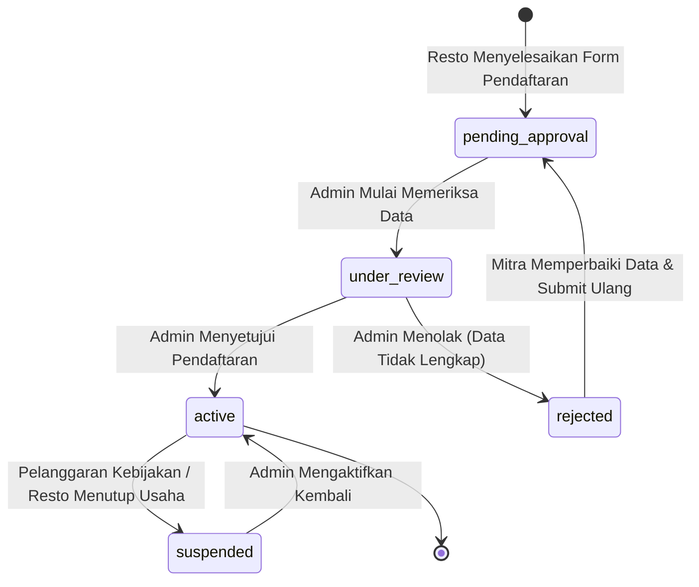
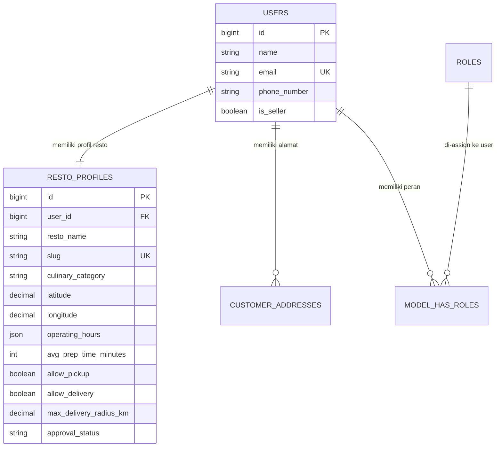

# 📝 Pemisahan Alur Registrasi Mitra Resto vs Pelanggan (Registration Flows & Architecture)

Dokumen ini merancang arsitektur pemisahan total antara pendaftaran **Pelanggan Makanan (*Customer*)** dengan pendaftaran **Mitra Resto / Dapur (*Resto Merchant*)**, mencakup rute, validasi, otorisasi peran (*Spatie roles*), dan alur persetujuan (*onboarding approval*).

---

## 1. Perbandingan Gerbang Masuk Registrasi (*Registration Gateways*)

```mermaid
flowchart TD
    UserArrival([Pengunjung Mengakses Situs]) --> DecisionBranch{Siapa Pengunjung?}

    DecisionBranch -- Ingin Pesan Makanan --> CustOption{Metode Pesan?}
    CustOption -- Tanpa Akun (Guest) --> GuestDirect[Langsung Pilih Menu & Checkout Instan]
    CustOption -- Ingin Buat Akun --> CustRegis[Akses /register (Registrasi Pelanggan)]
    CustRegis --> CustForm[Form Singkat: Nama, No WA, Email, Sandi]
    CustForm --> CustRole[Diberikan Spatie Role: 'Customer']
    CustRole --> CustHome[Mulai Belanja & Dapatkan Koin Poin]

    DecisionBranch -- Ingin Buka Resto / Dapur --> RestoRegis[Akses /register-resto (Daftar Mitra Resto)]
    RestoRegis --> RestoWizard[Wizard 5 Langkah Mitra Dapur]
    RestoWizard --> RestoPending[Status Akun: 'pending_approval']
    RestoPending --> AdminReview{Admin Review Berkas & Lokasi}
    AdminReview -- Ditolak --> RejectNotice[Kirim Alasan Penolakan via WhatsApp/Email]
    AdminReview -- Disetujui --> RestoActive[Status: 'active' & Role: 'Seller'/'RestoMerchant']
    RestoActive --> RestoPortal[Akses Dashboard Resto & Mulai Upload Menu]
```

---

## 2. Alur Registrasi Pelanggan (*Customer Register Flow*)

Pendaftaran pelanggan dirancang seringkas mungkin (*low friction*) untuk menjaga tingkat konversi (*conversion rate*):

### A. Rute & Komponen
- **Rute URL**: `/register`
- **Komponen Svelte**: `resources/js/pages/Auth/Register.svelte` (dengan adaptasi tampilan bertema kuliner saat `IS_FOODPICK=true`).
- **Opsi Alternatif**: 1-Click Login dengan Google OAuth (`/auth/google`).

### B. Kolom Data Pendaftaran
| Kolom Input | Tipe | Wajib | Keterangan & Validasi |
|---|---|:---:|---|
| **Nama Lengkap** | Text | Ya | Nama panggilan / pemesan. |
| **Nomor WhatsApp / HP** | Tel / Text | Ya | Format seluler Indonesia (08xx / 628xx), minimal 8 digit, unik. Digunakan untuk konfirmasi pesanan siap & kurir resto. |
| **Alamat Email** | Email | Ya | Format email valid, unik di tabel `users`. Digunakan untuk pengiriman nota pembayaran digital. |
| **Kata Sandi** | Password | Ya | Minimal 8 karakter, konfirmasi kata sandi. |

### C. Pasca-Pendaftaran Pelanggan
1. Diberikan peran Spatie: `Customer`.
2. Pengguna langsung dapat menambahkan alamat rumah atau kantor lengkap dengan titik pin GPS untuk akurasi pengantaran kurir resto.
3. Otomatis menerima bonus sambutan koin loyalitas pertama (misal: 5.000 Poin Koin).

---

## 3. Alur Registrasi Mitra Resto (*Resto Merchant Registration Flow*)

Pendaftaran mitra resto membutuhkan data operasional, legalitas, koordinat GPS dapur, dan informasi rekening pencairan hasil penjualan.

### A. Rute & Akses
- **Rute URL**: `/register-resto` atau `/mitra/daftar`
- **Proteksi**: Dapat diakses publik oleh calon pemilik resto, atau oleh pengguna terdaftar yang ingin meng-upgrade akunnya menjadi mitra resto.

### B. Formulir Bertahap (*Multi-Step Wizard*)

```
┌────────────────────────────────────────────────────────────────────────┐
│ 🍳 FORMULIR PENDAFTARAN MITRA RESTO BIZMATE                            │
│ [1. Pemilik] ─── [2. Info Resto] ─── [3. Lokasi GPS] ─── [4. Jam Buka] ─── [5. Rekening] │
└────────────────────────────────────────────────────────────────────────┘
```

#### Langkah 1: Data Penanggung Jawab / Pemilik Resto
- **Nama Lengkap Pemilik**: Sesuai kartu identitas (KTP).
- **Nomor Induk Kependudukan (NIK/KTP)**: Untuk verifikasi anti-fraud.
- **Nomor WhatsApp Utama**: Nomor kontak darurat pemilik resto.
- **Email Akun Login**: Kredensial untuk masuk ke panel resto.
- **Kata Sandi**: Hash sandi akun pengelola resto.

#### Langkah 2: Identitas Resto & Konsep Kuliner
- **Nama Resto / Dapur**: Nama komersial yang tampil di storefront (contoh: *"Warung Sambal Bakar Nusantara"*).
- **Kategori Kuliner**: Dropdown pilihan (misal: Aneka Nasi, Seafood, Kopi & Minuman, Cepat Saji, Jajanan & Snack, Makanan Sehat).
- **Deskripsi Resto**: Ringkasan menu andalan dan keunikan cita rasa.
- **Foto Profil / Logo Resto**: Gambar logo rasio 1:1.
- **Foto Sampul Banner Resto**: Foto suasana tempat atau etalase makanan (rasio 16:9).

#### Langkah 3: Lokasi Dapur & Koordinat GPS Presisi
> [!IMPORTANT]
> Koordinat GPS dapur adalah **kunci vital** dalam ekosistem FoodPick, karena sistem menggunakan rumus *Haversine* untuk menentukan apakah pelanggan berada dalam jangkauan antar kurir resto dan menghitung ongkos kirim secara akurat.

- **Alamat Lengkap Dapur**: Nama jalan, nomor bangunan, RT/RW, kelurahan, kecamatan, kota/kabupaten, dan kode pos.
- **Pin Peta Interaktif (Leaflet / Google Maps Picker)**:
  - Input otomatis: `latitude` (contoh: `-7.98261450`) dan `longitude` (contoh: `112.63078920`).
- **Petunjuk Tambahan / Patokan Dapur**: (misal: *"Depan kantor pos, gerbang pagar hijau"*).

#### Langkah 4: Jam Operasional & Layanan Dapur
- **Jam Buka & Tutup per Hari**:
  - Senin s/d Minggu: Format Jam Buka (contoh: `09:00`) hingga Jam Tutup (contoh: `21:30`).
- **Estimasi Waktu Memasak Rata-Rata**: Pilihan durasi standar (misal: 15 menit, 20 menit, 30 menit).
- **Opsi Layanan yang Disediakan**:
  - `[x]` Menerima Ambil di Resto (*Self-Pickup / Takeaway / Dine-in*).
  - `[x]` Menerima Pengantaran Kurir Resto (*Resto Delivery*).
    - Batas Maksimal Radius Pengantaran Kurir Resto: (contoh: `7 km`).
    - Skema Tarif Kurir Resto: Tarif flat (misal: Rp 10.000) atau tarif per-km (misal: Rp 2.500/km).

#### Langkah 5: Metode Pembayaran Resto & Rekening Pencairan (*Resto Payment Setup*)
- **Saluran Pembayaran Mandiri yang Disediakan Resto**:
  - `[x]` **Bayar di Tempat (COD / Kasir Resto)**: Pelanggan membayar uang pas saat pesanan diterima.
  - `[x]` **Transfer Bank Langsung**:
    - **Nama Bank**: (BCA, Mandiri, BRI, BNI, Bank Jatim, CIMB, dll.).
    - **Nomor Rekening Bank**: Nomor rekening resmi penampung pembayaran dari pembeli.
    - **Nama Pemilik Rekening**: Wajib sesuai dengan buku tabungan.
  - `[x]` **QRIS Resto Manual**:
    - Unggah Foto Kode QRIS resmi resto (JPG/PNG).
    - Nama Merchant Tertera pada QRIS.
    - Instruksi scan e-wallet / m-banking.
  - `[x]` **Payment Gateway: WARIS QRIS Dinamis Resto**:
    - Sakelar aktif/nonaktif payment gateway mandiri resto.
    - API URL, API Key, Webhook Secret, QRIS Code, dan Admin Fee.
    - Notifikasi pelunasan instan otomatis via endpoint webhook `/api/webhooks/waris`.
- Seluruh pengaturan pembayaran ini dapat disesuaikan kembali kapan saja di menu `/admin/resto-profile`.

---

## 4. Siklus Verifikasi & Persetujuan Resto (*Resto Approval Lifecycle*)



### Prosedur Verifikasi oleh Tim Admin (`/admin/resto/approvals`):
1. **Pemeriksaan Titik Lokasi**: Admin memastikan titik GPS resto berada di daratan yang valid dan tidak fiktif.
2. **Pemeriksaan Kategori & Menu**: Memastikan jenis kuliner sesuai dengan standar platform.
3. **Pemberitahuan Otomatis**:
   - Jika **Disetujui**: Sistem mengirim pesan WhatsApp & Email otomatis:
     > *"Selamat! Resto [Nama Resto] telah disetujui. Silakan masuk ke Dashboard Resto Anda untuk mulai menambahkan menu makanan."*
   - Jika **Ditolak**: Sistem menyertakan catatan kekurangan (misal: *"Foto buku tabungan buram, silakan upload ulang"*).

---

## 5. Hubungan Data & Skema Peran Spatie



- **User Pelanggan**:
  - `is_seller = false`
  - Spatie Role: `Customer`
- **User Pemilik Resto**:
  - `is_seller = true`
  - Spatie Role: `Seller` (atau `RestoMerchant`)
  - Memiliki entitas anak pada tabel `resto_profiles` yang menyimpan seluruh konfigurasi dapur dan jadwal operasionalnya.

