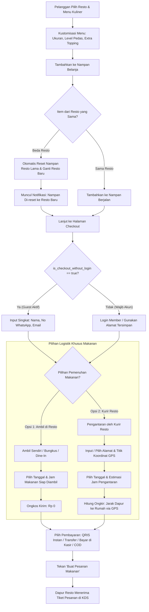
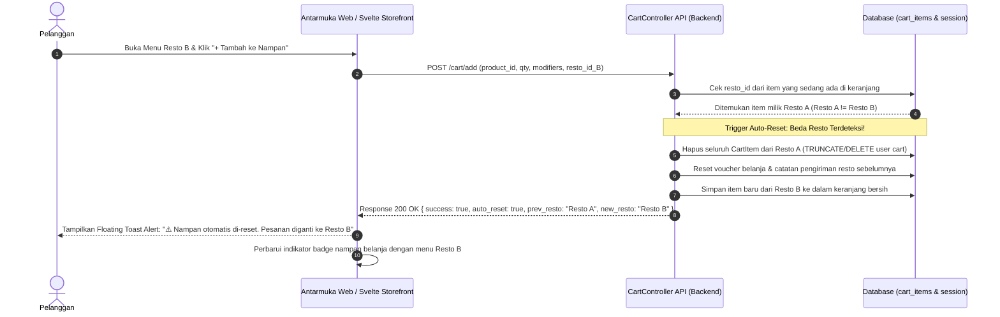
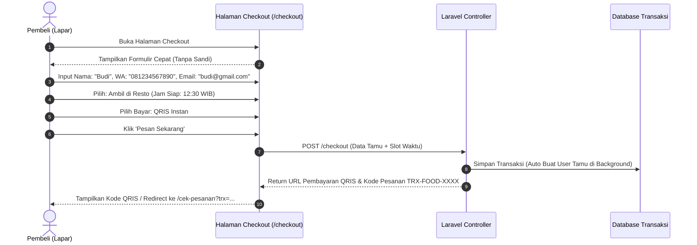
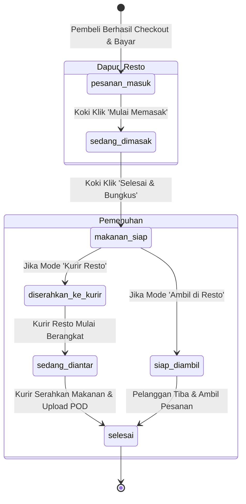

# 🍳 Alur Pemesanan Makanan, Sistem Dapur (KDS) & Logistik Pengambilan/Pengantaran

Dokumen ini memetakan seluruh alur transaksi pemesanan makanan, validasi checkout tanpa login (*Guest Checkout*), seleksi slot waktu siap saji, mekanisme dapur (*Kitchen Display System*), serta pengantaran kurir internal resto.

---

## 1. Diagram Alur Transaksi Makanan Menyeluruh (*End-to-End Workflow*)

---

## 2. Mekanisme Reset Otomatis Nampan Transaksi Beda Resto (*Automatic Cart Reset Engine*)

Untuk memastikan tidak terjadi percampuran pesanan dari dapur yang berbeda, sistem menerapkan **Aturan 1 Resto Terpilih** dengan alur reset otomatis:

### Rincian Perilaku Reset Otomatis:
1. **Pembersihan Bersih (*Clean Slate*)**:
   - Menghapus semua baris `cart_items` yang terkait dengan sesi/pengguna aktif.
   - Menghapus klaim voucher promo diskon toko milik Resto A.
   - Mengosongkan data kalkulasi jarak kurir resto dan pilihan meja/catatan dari Resto A.
2. **Penyisipan Instan Item Resto Baru**:
   - Menu yang baru dipilih dari Resto B langsung tersimpan tanpa mengharuskan pengguna bolak-balik menghapus keranjang secara manual.
3. **Notifikasi Visual Transparan (*Floating Toast*)**:
   - Banner pop-up berwarna amber/oranye muncul di sudut layar:
     > ℹ️ *"Nampan pesanan Anda sebelumnya dari [Nama Resto A] telah otomatis di-reset. Sekarang Anda memesan dari [Nama Resto B]."*
4. **Validasi Anti-Bypass pada Saat Checkout**:
   - Pada saat submit form checkout (`POST /checkout`), controller backend memvalidasi kembali bahwa semua `product_id` berasal dari satu `resto_id`. Jika terdapat anomali atau manipulasi request beda resto, transaksi ditolak (*HTTP 422 Unprocessable Content*).

---

## 3. Alur Checkout Tanpa Login (*Guest Checkout for Food*)

Dalam bisnis kuliner online, kecepatan memesan adalah faktor penentu konversi penjualan. Saat `is_checkout_without_login=true`, pelanggan tidak dibebani proses pendaftaran akun:

---

## 4. Seleksi Logistik & Format Tanggal / Jam Slot Waktu

Pada mode FoodPick (`IS_FOODPICK=true`), kurir ekspedisi luar kota (JNE, J&T, SiCepat, dll.) **disembunyikan secara otomatis**. Sistem hanya menampilkan dua mode pemenuhan lokal:

### Mode A: Ambil Sendiri di Resto (*Self-Pickup / Takeaway / Dine-in*)
- **Biaya Pengiriman**: **Rp 0 (Gratis)**.
- **Pilihan Layanan**:
  - `(o)` **Bungkus Bawa Pulang (*Takeaway*)**: Makanan dikemas dalam kantong/box tahan panas.
  - `( )` **Makan di Tempat (*Dine-In*)**: Pelanggan memilih makan langsung di resto + input **Nomor Meja** (opsional).
- **Format Pilihan Waktu Pengambilan**:
  - **Tanggal Pengambilan**: `[ Hari Ini (13 Nov 2026) v ]` atau `[ Besok (14 Nov 2026) ]`.
  - **Estimasi Jam Makanan Siap Diambil**:
    - Dihitung otomatis: $\text{Jam Sekarang} + \text{Waktu Masak Dapur}$ (misal: sekarang pukul 12:05 + 20 menit = paling cepat pukul **12:25**).
    - Pilihan dropdown slot (interval 15 menit):
      - `[ 12:25 WIB (Paling Cepat / Siap dalam 20 menit) ]` *(Default terpilih)*
      - `[ 12:45 WIB ]`
      - `[ 13:00 WIB ]`
      - `[ 13:15 WIB ]`
      - `[ 13:30 WIB ]`
      - `[ 17:00 WIB (Ambil Sore Pulang Kerja) ]`

---

### Mode B: Pengantaran Kurir Resto (*Resto Delivery / Internal Courier*)
- **Armada Pengantar**: Dikelola langsung oleh kurir internal resto/toko.
- **Kalkulasi Ongkos Kirim**:
  - Menghitung jarak lurus geografis menggunakan formula **Haversine**:
    $$d = 2r \arcsin\left(\sqrt{\sin^2\left(\frac{\Delta \text{lat}}{2}\right) + \cos(\text{lat}_1)\cos(\text{lat}_2)\sin^2\left(\frac{\Delta \text{long}}{2}\right)}\right)$$
  - Di mana titik awal $(\text{lat}_1, \text{long}_1)$ adalah koordinat GPS Dapur Resto, dan titik tujuan $(\text{lat}_2, \text{long}_2)$ adalah koordinat GPS rumah pemesan.
  - Skema tarif:
    - **Tarif Per Kilometer**: Dikalikan dengan jarak km pembulatan ke atas.
    - **Tarif Flat**: Tarif tetap per pengantaran (misal: Rp 10.000).
    - **Promo Gratis Ongkir Resto**: Jika total nilai pesanan mencapai ambang batas belanja gratis ongkir (`delivery_free_min_order`).
  - **Penanganan Koordinat Tamu (*Smart Fallback*)**: Bila pembeli tamu belum menandai pin lokasi GPS (hanya memilih area/kecamatan), sistem secara cerdas menggunakan tarif dasar pengantaran resto dan tidak memunculkan pesan error "Tidak ada layanan pengiriman yang tersedia".
- **Format Pilihan Waktu Pengantaran**:
  - **Tanggal Pengantaran**: `[ Hari Ini v ]`.
  - **Estimasi Jam Pengantaran ke Alamat**:
    - Slot waktu: `[ 12:45 - 13:00 WIB (Estimasi Tiba) v ]`, `[ 13:00 - 13:15 WIB ]`, dst.

---

### Mode C: Metode Pembayaran Mandiri Per Resto
Saat berada di langkah pembayaran checkout, sistem secara dinamis hanya menampilkan metode pembayaran yang aktif di resto terpilih:
1. **Bayar di Tempat (COD / Kasir Resto)**: Pelanggan membayar uang tunai saat pesanan diserahkan (baik ambil sendiri di kasir maupun diantar kurir ke rumah). Halaman cek pesanan (`/cek-pesanan`) menampilkan kartu petunjuk penyiapan uang pas tanpa box transfer palsu. Begitu kasir atau kurir menandai pesanan selesai, sistem secara otomatis melunasi status pembayaran (`payment_status = paid`).
2. **Transfer Bank Rekening Resto**: Menampilkan nama bank, nomor rekening, dan atas nama pemilik resto terpilih. Pelanggan dapat mengunggah bukti bayar pada halaman `/cek-pesanan`.
3. **QRIS Resto Manual**: Menampilkan barcode QRIS resmi resto untuk di-scan via GoPay, OVO, ShopeePay, DANA, BCA Mobile, dll.
4. **WARIS QRIS Dinamis Resto (Gateway Otomatis)**: Generate QR dinamis dengan nominal unik real-time dari gateway Waris milik resto. Pelunasan otomatis terverifikasi tanpa perlu konfirmasi manual koki melalui webhook `/api/webhooks/waris`.

---

## 5. Alur Kerja Dapur: Kitchen Display System (KDS)

Setelah pembayaran terkonfirmasi (atau memilih bayar tunai), pesanan secara real-time masuk ke layar monitor dapur resto (`/resto/kds`):

### Rincian Tindakan di Setiap Tahap:
1. **Status: `pesanan_masuk`**:
   - Bel lonceng berbunyi di dapur.
   - Tiket pesanan menampilkan rincian menu: 
     - *2x Nasi Ayam Geprek (Level 3 - Ekstra Pedas, Tambah Telur Mata Sapi, Catatan: Sambal dipisah)*.
     - *1x Es Teh Manis*.
     - Target Jam Siap: **12:30 WIB**.
2. **Status: `sedang_dimasak`**:
   - Koki menekan tombol "Mulai Masak".
   - Layar pelacakan pembeli (`/cek-pesanan`) otomatis berubah warna menjadi kuning: *"Dapur sedang memasak pesanan Anda"*.
3. **Status: `makanan_siap`**:
   - Makanan selesai dimasak dan dikemas rapi. Koki menekan tombol "Makanan Siap".
   - **Jika Ambil Sendiri**: Sistem otomatis mengirim notifikasi WhatsApp/Email ke pembeli:
     > *"Halo [Nama], pesanan makanan Anda di [Nama Resto] sudah matang dan siap diambil di kasir resto. Nomor pesanan: TRX-FOOD-0042."*
   - **Jika Kurir Resto**: Sistem memanggil aplikasi kurir internal resto untuk mengambil paket di dapur dan meluncur ke alamat pembeli.
4. **Status: `selesai`**:
   - Makanan telah diserahkan. Dana masuk ke saldo omset resto. Poin koin reward dicairkan ke pembeli.

