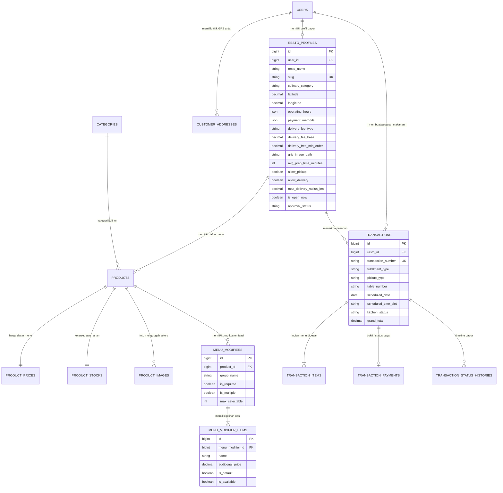

# 🗄️ Skema Database & Modifikasi Master Data FoodPick (Database Architecture)

Dokumen ini mendefinisikan ekstensi skema database, diagram relasi entitas (*Entity Relationship Diagram - ERD*), rancangan migrasi Laravel, serta kamus data untuk mendukung operasional multi-resto **FoodPick** tanpa merusak integritas tabel e-commerce yang sudah ada.

---

## 1. Diagram Relasi Entitas FoodPick (*FoodPick ERD*)



---

## 2. Kamus Data Tabel Ekstensi FoodPick

### A. Tabel `resto_profiles`
Menyimpan identitas, koordinat GPS dapur, jam operasional, dan parameter logistik dari setiap mitra resto.

| Nama Kolom | Tipe Data | Nullable | Default | Penjelasan & Aturan Bisnis |
|---|---|:---:|:---:|---|
| `id` | `BIGINT UNSIGNED` | NO | Auto PK | Pengenal unik profil resto. |
| `user_id` | `BIGINT UNSIGNED` | NO | FK | Terhubung ke `users.id` (pemilik resto ber-role `Seller`). |
| `resto_name` | `VARCHAR(255)` | NO | - | Nama komersial restoran / warung / dapur. |
| `slug` | `VARCHAR(255)` | NO | Unique | URL publik restoran (contoh: `/resto/bebek-sinjay-malang`). |
| `culinary_category`| `VARCHAR(100)` | NO | - | Kategori kuliner utama (misal: "Aneka Ayam & Bebek", "Kopi"). |
| `description` | `TEXT` | YES | NULL | Profil singkat, sertifikasi halal, atau cerita cita rasa. |
| `logo_path` | `VARCHAR(255)` | YES | NULL | Foto logo resto (rasio 1:1). |
| `banner_path` | `VARCHAR(255)` | YES | NULL | Foto banner etalase resto (rasio 16:9). |
| `address` | `TEXT` | NO | - | Alamat fisik dapur lengkap. |
| `latitude` | `DECIMAL(10,8)` | NO | - | **Titik Latitude GPS Dapur** (untuk kalkulasi jarak Haversine). |
| `longitude` | `DECIMAL(11,8)` | NO | - | **Titik Longitude GPS Dapur** (untuk kalkulasi jarak Haversine). |
| `operating_hours` | `JSON` | NO | - | Matriks jam buka-tutup Senin-Minggu: `{"senin":{"open":"09:00","close":"21:00","is_closed":false},...}`. |
| `payment_methods` | `JSON` | YES | NULL | Konfigurasi metode bayar mandiri resto: COD (`is_active`, `instructions`), transfer bank (`is_active`, `bank_name`, `account_number`, `account_holder`), QRIS resto (`is_active`, `merchant_name`, `image_url`), dan Payment Gateway Waris QRIS Dinamis Resto (`is_active`, `api_url`, `api_key`, `webhook_secret`, `qris_code`, `admin_fee`). |
| `delivery_fee_type` | `VARCHAR(30)` | NO | `'flat'` | Skema tarif pengantaran kurir resto: `'flat'` (sama rata) atau `'per_km'` (per kilometer). |
| `delivery_fee_base` | `DECIMAL(12,2)` | NO | `10000.00` | Tarif ongkir dasar / biaya per kilometer. |
| `delivery_free_min_order` | `DECIMAL(12,2)` | NO | `0.00` | Ambang batas nilai belanja untuk mendapatkan Gratis Ongkir Resto (0 = nonaktif). |
| `qris_image_path` | `VARCHAR(255)` | YES | NULL | Lokasi file foto/gambar QRIS resmi milik resto. |
| `avg_prep_time_minutes`| `INT` | NO | `20` | Rata-rata durasi koki memasak menu standar (menit). |
| `allow_pickup` | `BOOLEAN` | NO | `true` | Apakah resto menerima pesanan Ambil Sendiri / Bungkus. |
| `allow_delivery` | `BOOLEAN` | NO | `true` | Apakah resto menerima pengantaran kurir internal. |
| `max_delivery_radius_km`| `DECIMAL(5,2)` | NO | `7.00` | Batas jarak terjauh kurir resto mengantar (kilometer). |
| `is_open_now` | `BOOLEAN` | NO | `true` | Sakelar darurat koki: Buka / Tutup Sementara jika dapur ramai. |
| `approval_status` | `VARCHAR(50)` | NO | `'pending_approval'` | Status verifikasi admin: `'pending_approval'`, `'active'`, `'rejected'`, `'suspended'`. |

---

### B. Tabel `menu_modifiers` & `menu_modifier_items`
Mendukung kustomisasi menu makanan yang 100% dinamis dan dapat diatur mandiri oleh mitra resto atau admin melalui `/admin/products/{id}/modifiers`.

> [!IMPORTANT]
> **Prinsip Nol Hardcoded**: Aplikasi tidak memaksakan opsi varian atau modifier fiktif (seperti Level Pedas, Nasi, atau Topping) secara default di frontend. Jika sebuah menu makanan belum dikonfigurasikan modifier-nya pada tabel ini, maka etalase toko menyajikannya sebagai menu standar dengan input kuantitas dan catatan koki dapur tanpa pilihan tambahan palsu.

#### Tabel `menu_modifiers` (Grup Kustomisasi):
| Nama Kolom | Tipe Data | Nullable | Default | Penjelasan |
|---|---|:---:|:---:|---|
| `id` | `BIGINT UNSIGNED` | NO | Auto PK | Pengenal unik grup. |
| `product_id` | `BIGINT UNSIGNED` | NO | FK | Terhubung ke menu makanan (`products.id`). |
| `group_name` | `VARCHAR(100)` | NO | - | Nama grup: *"Pilihan Level Pedas"*, *"Ekstra Topping"*. |
| `is_required` | `BOOLEAN` | NO | `false` | True = Wajib dipilih minimal 1 (misal: Level Pedas). |
| `is_multiple` | `BOOLEAN` | NO | `false` | True = Checkbox (bisa pilih banyak topping); False = Radio. |
| `max_selectable`| `INT` | YES | NULL | Batas maksimal pilihan (misal: maksimal 3 topping). |

#### Tabel `menu_modifier_items` (Opsi Pilihan):
| Nama Kolom | Tipe Data | Nullable | Default | Penjelasan |
|---|---|:---:|:---:|---|
| `id` | `BIGINT UNSIGNED` | NO | Auto PK | Pengenal unik opsi. |
| `menu_modifier_id`| `BIGINT UNSIGNED`| NO | FK | Terhubung ke `menu_modifiers.id`. |
| `name` | `VARCHAR(100)` | NO | - | Nama opsi (contoh: *"Level 3 - Ekstra Pedas"*, *"Tambah Telur Mata Sapi"*). |
| `additional_price`| `DECIMAL(12,2)`| NO | `0.00` | Tambahan harga (misal: +Rp 4.000 untuk telur). |
| `is_default` | `BOOLEAN` | NO | `false` | True jika opsi otomatis terpilih saat modal dibuka. |
| `is_available`| `BOOLEAN` | NO | `true` | True = Tersedia; False = Topping ini sedang habis. |

---

### C. Penambahan Kolom pada Tabel `transactions`
Menyimpan spesifikasi logistik makanan tanpa memecah skema transaksi yang lama:

```sql
ALTER TABLE `transactions`
ADD COLUMN `resto_id` BIGINT UNSIGNED NULL AFTER `user_id`,
ADD COLUMN `fulfillment_type` ENUM('self_pickup', 'store_courier') DEFAULT 'self_pickup' AFTER `shipping_courier`,
ADD COLUMN `pickup_type` ENUM('takeaway', 'dine_in') DEFAULT 'takeaway' AFTER `fulfillment_type`,
ADD COLUMN `table_number` VARCHAR(50) NULL AFTER `pickup_type`,
ADD COLUMN `scheduled_date` DATE NULL AFTER `pickup_at`,
ADD COLUMN `scheduled_time_slot` VARCHAR(50) NULL AFTER `scheduled_date`,
ADD COLUMN `kitchen_status` VARCHAR(50) DEFAULT 'pesanan_masuk' AFTER `status`;
```

- `fulfillment_type`: Menentukan apakah makanan **Ambil Sendiri** (`'self_pickup'`) atau **Diantar Kurir Resto** (`'store_courier'`).
- `pickup_type`: Jika ambil sendiri, apakah dibungkus pulang (`'takeaway'`) atau makan di meja resto (`'dine_in'`).
- `table_number`: Nomor meja pelanggan jika memesan dari meja resto secara mandiri.
- `scheduled_date` & `scheduled_time_slot`: Menyimpan tanggal dan slot jam makanan siap diambil atau jam pengantaran (misal: `scheduled_date = '2026-11-13'`, `scheduled_time_slot = '12:30 WIB'`).
- `kitchen_status`: Tahapan dapur: `'pesanan_masuk'`, `'sedang_dimasak'`, `'siap_diambil'`, `'sedang_diantar'`, `'selesai'`.

---

## 3. Blueprint Migrasi Aman Laravel (*Zero Breaking Migration*)

```php
<?php

use Illuminate\Database\Migrations\Migration;
use Illuminate\Database\Schema\Blueprint;
use Illuminate\Support\Facades\Schema;

return new class extends Migration
{
    public function up(): void
    {
        // 1. Buat Tabel Profil Resto
        Schema::create('resto_profiles', function (Blueprint $table) {
            $table->id();
            $table->foreignId('user_id')->constrained()->cascadeOnDelete();
            $table->string('resto_name');
            $table->string('slug')->unique();
            $table->string('culinary_category');
            $table->text('description')->nullable();
            $table->string('logo_path')->nullable();
            $table->string('banner_path')->nullable();
            $table->text('address');
            $table->decimal('latitude', 10, 8);
            $table->decimal('longitude', 11, 8);
            $table->json('operating_hours');
            $table->integer('avg_prep_time_minutes')->default(20);
            $table->boolean('allow_pickup')->default(true);
            $table->boolean('allow_delivery')->default(true);
            $table->decimal('max_delivery_radius_km', 5, 2)->default(7.00);
            $table->boolean('is_open_now')->default(true);
            $table->string('approval_status')->default('pending_approval');
            $table->timestamps();

            $table->index(['latitude', 'longitude']);
            $table->index('approval_status');
        });

        // 2. Buat Tabel Menu Modifiers (Level Pedas & Topping)
        Schema::create('menu_modifiers', function (Blueprint $table) {
            $table->id();
            $table->foreignId('product_id')->constrained()->cascadeOnDelete();
            $table->string('group_name');
            $table->boolean('is_required')->default(false);
            $table->boolean('is_multiple')->default(false);
            $table->integer('max_selectable')->nullable();
            $table->timestamps();
        });

        Schema::create('menu_modifier_items', function (Blueprint $table) {
            $table->id();
            $table->foreignId('menu_modifier_id')->constrained()->cascadeOnDelete();
            $table->string('name');
            $table->decimal('additional_price', 12, 2)->default(0.00);
            $table->boolean('is_default')->default(false);
            $table->boolean('is_available')->default(true);
            $table->timestamps();
        });

        // 3. Tambahkan Kolom Khusus FoodPick ke Tabel Transactions (Nullable agar aman untuk e-commerce)
        Schema::table('transactions', function (Blueprint $table) {
            $table->foreignId('resto_id')->nullable()->after('user_id');
            $table->string('fulfillment_type')->default('self_pickup')->after('shipping_courier');
            $table->string('pickup_type')->default('takeaway')->after('fulfillment_type');
            $table->string('table_number')->nullable()->after('pickup_type');
            $table->date('scheduled_date')->nullable()->after('pickup_at');
            $table->string('scheduled_time_slot')->nullable()->after('scheduled_date');
            $table->string('kitchen_status')->default('pesanan_masuk')->after('status');
        });
    }

    public function down(): void
    {
        Schema::table('transactions', function (Blueprint $table) {
            $table->dropColumn([
                'resto_id', 'fulfillment_type', 'pickup_type',
                'table_number', 'scheduled_date', 'scheduled_time_slot', 'kitchen_status'
            ]);
        });
        Schema::dropIfExists('menu_modifier_items');
        Schema::dropIfExists('menu_modifiers');
        Schema::dropIfExists('resto_profiles');
    }
};
```

---

## 4. Logika Penegakan 1 Resto & Auto-Reset Keranjang pada Backend (*Cart Auto-Reset Logic*)

Berikut implementasi logika backend pada `CartController` atau Action Service untuk menjamin **hanya 1 resto** yang ada di nampan belanja:

```php
namespace App\Actions\FoodPick;

use App\Models\CartItem;
use App\Models\Product;
use Illuminate\Http\Request;

class AddToCartAction
{
    public function execute(Request $request): array
    {
        $productId = $request->input('product_id');
        $quantity = $request->input('quantity', 1);
        $modifiers = $request->input('modifiers', []); // [modifier_item_id, ...]
        $notes = $request->input('notes');

        $product = Product::findOrFail($productId);
        $newRestoId = $product->user_id; // User ID pemilik resto

        $userId = auth()->id();
        $sessionId = session()->getId();

        // 1. Ambil item yang sedang ada di nampan belanja
        $existingCart = CartItem::query()
            ->when($userId, fn($q) => $q->where('user_id', $userId))
            ->when(!$userId, fn($q) => $q->where('session_id', $sessionId))
            ->with('product')
            ->get();

        $cartWasReset = false;
        $prevRestoName = null;

        // 2. Evaluasi: Apakah terdapat item dari resto yang berbeda?
        if ($existingCart->isNotEmpty()) {
            $firstItem = $existingCart->first();
            $currentRestoId = $firstItem->product->user_id;

            if ($currentRestoId !== $newRestoId) {
                $prevRestoName = $firstItem->product->user->name ?? 'Resto Sebelumnya';

                // EKSEKUSI RESET OTOMATIS: Hapus seluruh item nampan lama
                CartItem::query()
                    ->when($userId, fn($q) => $q->where('user_id', $userId))
                    ->when(!$userId, fn($q) => $q->where('session_id', $sessionId))
                    ->delete();

                $cartWasReset = true;
            }
        }

        // 3. Masukkan item menu dari resto baru ke nampan bersih
        $cartItem = CartItem::create([
            'user_id' => $userId,
            'session_id' => $userId ? null : $sessionId,
            'product_id' => $productId,
            'quantity' => $quantity,
            'is_checked' => true,
            'notes' => json_encode([
                'modifiers' => $modifiers,
                'customer_notes' => $notes,
            ]),
        ]);

        return [
            'success' => true,
            'cart_was_reset' => $cartWasReset,
            'prev_resto' => $prevRestoName,
            'new_resto' => $product->user->name ?? 'Resto Baru',
            'cart_item' => $cartItem,
        ];
    }
}
```

### Validasi Integritas Saat Checkout (`POST /checkout`):
```php
$cartRestoCount = CartItem::query()
    ->where('user_id', auth()->id())
    ->join('products', 'cart_items.product_id', '=', 'products.id')
    ->distinct('products.user_id')
    ->count('products.user_id');

if ($cartRestoCount > 1) {
    throw ValidationException::withMessages([
        'cart' => 'Pesanan hanya boleh berasal dari 1 Resto dalam satu transaksi.',
    ]);
}
```


